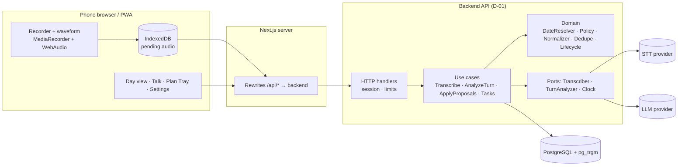
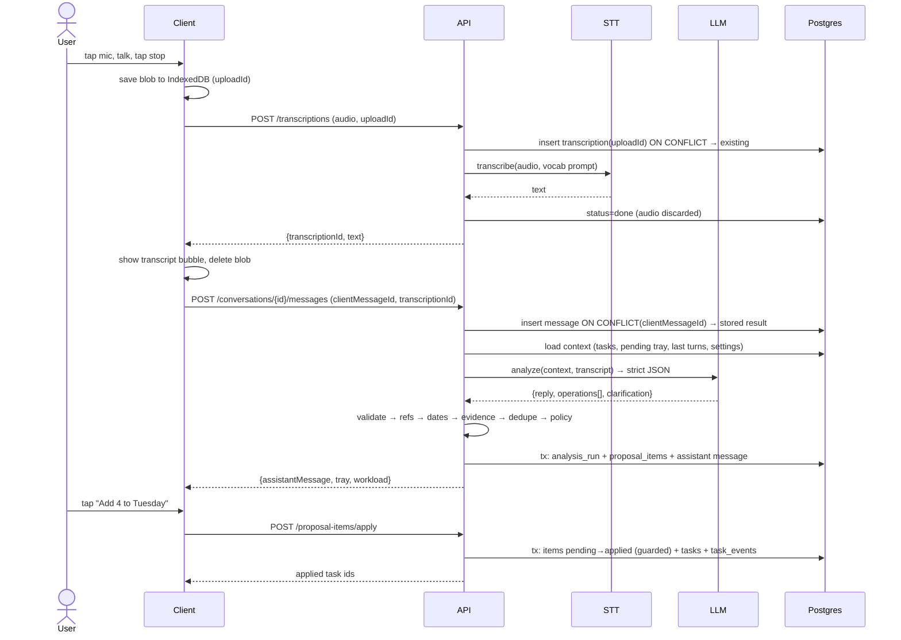

# Architecture & AI Pipeline

Status: Approved for planning (rev 2) · Last updated 2026-11-22
Related: [product-requirements.md](product-requirements.md) · [data-and-api.md](data-and-api.md) · [roadmap-and-testing.md](roadmap-and-testing.md) · [decisions.md](decisions.md)

The backend language is **open decision D-01** (ASP.NET Core, Go, or all-TypeScript). Everything below is written language-neutral unless it says otherwise.

---

## 1. Technology stack

### 1.1 Fixed choices (independent of D-01)

| Layer | Choice | Why |
|---|---|---|
| Frontend | Next.js (App Router, current stable), TypeScript, Tailwind, shadcn/ui, Motion | Team preference. Mostly client components. |
| Client state | TanStack Query, plus a small reducer state machine for the recorder | No global store needed. |
| API types | `openapi.yaml` → `openapi-typescript` client | One source for the contract. |
| Same-origin | **Next.js rewrites** `/api/*` → backend | First-party cookies, no CORS, no reverse proxy needed. |
| PWA | Manifest + Serwist, caching the app shell only | Offline use is V1. |
| DB | PostgreSQL 17 (managed) + `pg_trgm` | Trigram dedupe. No vector DB. |
| AI ports | `Transcriber` and `TurnAnalyzer` interfaces in the backend | Swappable and mockable. |
| Real-time | None. A 2-step HTTP flow (transcribe, then analyze) | SSE in V1. |
| Logging | Structured JSON logs with transcript redaction. Run tables have `latency_ms`, `tokens`, and `cost_usd` columns. | OpenTelemetry is V1 hardening. |
| Local dev | Docker Compose for Postgres | Only where it earns its place. |
| STT bake-off | **Throwaway Python script** in `spikes/stt-bakeoff/`, using `jiwer` for WER/CER | Fast to write. Its outputs feed the real eval runner. |

**Not used:** Redis, queues, a vector DB, microservices, or agent frameworks. At this scale, one structured LLM call plus deterministic code is more reliable.

### 1.2 Backend language comparison (D-01, open)

| Concern | ASP.NET Core (.NET 10 LTS) | Go (current stable) | All-TypeScript (Next.js route handlers) |
|---|---|---|---|
| HTTP | Minimal APIs | `net/http` (1.22+ routing) or chi | Route handlers |
| DB | EF Core + Npgsql, EF migrations | `pgx` + `sqlc` (type-safe SQL), `goose` migrations | Drizzle + drizzle-kit |
| Local dates | **NodaTime `LocalDate`** + tzdb, the best fit | `time` + `LoadLocation` with embedded `time/tzdata`. Needs a small civil-date type, for example `cloud.google.com/go/civil`. | Temporal polyfill or date-fns-tz |
| Session auth (seeded users) | Cookie auth + password hasher | `alexedwards/scs` + bcrypt | iron-session + bcrypt |
| LLM structured output | Official SDKs / Microsoft.Extensions.AI | Official Go SDKs from the major vendors, plus a JSON-schema validator such as `santhosh-tekuri/jsonschema` | Vercel AI SDK + Zod, the smoothest |
| OpenAPI | Can be generated from code | Spec-first, with `oapi-codegen` for server stubs | Zod-to-OpenAPI, or shared types without OpenAPI |
| Tests | xUnit + Testcontainers | `testing` + testcontainers-go, table tests | Vitest + Testcontainers |
| Deployables | 2 (Next + API) | 2 (Next + one static binary) | 1 |
| Learning value for us | Low, unless C# is a goal | **High: we're both learning Go** | Medium |
| Speed to MVP | Medium | Medium at first, with about 20% learning overhead | Fastest |

**Lean (not decided):**
- **Go** fits well if learning it is a real goal and neither of us is already fluent in C#. The backend is mostly SQL plus an explicit validation pipeline. The rev-2 scope cuts also removed most of what ASP.NET's built-in features were buying: registration, OpenTelemetry, If-Match, and idempotency middleware. The costs are more hand-written code, a small civil-date type, and about 20% extra on the backend phases.
- **ASP.NET Core** is the better pick if one of us is already productive in C# and shipping sooner matters more than learning.
- **All-TypeScript** is the right call only if speed to a working MVP beats everything else.

D-01 must be decided **before Phase 0**, because the domain core and the eval runner are written in the backend language.

### 1.3 Backend layout (any language)

| Module | Contents |
|---|---|
| `domain` | Pure logic: date resolver, normalizer, dedupe, evidence matcher, policy, lifecycle, validator |
| `app` | Use cases: Transcribe, AnalyzeTurn, ApplyProposals, Tasks |
| `store` | Postgres access |
| `ai` | Adapters behind the `Transcriber` and `TurnAnalyzer` ports |
| `api` | HTTP handlers, session, and limits |
| `cmd/eval` | Eval runner |

### 1.4 Speech-to-text: bake-off, then one adapter

| Candidate | Why it's in the bake-off |
|---|---|
| OpenAI `gpt-4o-transcribe` / `-mini-transcribe` | Strong multilingual support and prompt biasing |
| Groq-hosted Whisper large-v3 / turbo | Fastest and cheapest, with prompt biasing |
| ElevenLabs Scribe | Reported to be strong on Arabic dialects |
| Google Chirp `ar-EG` (optional) | Has a dialect locale |
| Self-hosted faster-whisper | Not in the bake-off. Considered for V2 only if privacy or cost demands it. |

**Method:**
1. The Python script sends our **20 recorded clips** to each candidate.
2. It records WER/CER, latency, and cost per minute.
3. It also records **entity accuracy**: names, English terms, and numbers like "محاضرة 4".
4. It writes `transcripts/<provider>.json`.
5. The real eval runner reads those files and computes **downstream task F1** for each provider. The winner is chosen on downstream F1 first.
6. Only the winner gets a production `Transcriber` adapter, built in Phase 3.

Every call is biased with a short prompt listing open task titles and names.

### 1.5 LLM

The choice is provider-agnostic. The model needs strict JSON-schema output, strong Egyptian Arabic, prompt caching, and no-training API terms.

- **Build one adapter** for the strongest candidate on a quick manual check.
- **Add a second adapter only if the first misses the quality gate** after prompt iteration.
- The model ID is pinned. Any change to the model or the prompt needs a passing eval run.

---

## 2. High-level architecture



### 2.1 Primary voice turn



The turn uses two HTTP steps instead of one. The transcript appears in 1–3 s, which gives a chance to correct it. Each step can be retried on its own, with no WebSocket needed.

---

## 3. AI conversation & task extraction

### 3.1 Design stance

There is one **structured turn-analysis call** per user message. It returns the reply and the operations together. Deterministic code then decides what reaches the user: the model proposes, and the code disposes.

If evaluation shows that generating the reply hurts extraction, the call gets split into extraction and then reply. The split happens behind the same port, with no API change.

### 3.2 Context sent to the model

The server builds this context for each turn.

- **System prompt.** A versioned file in the repo, `prompts/turn-analyzer/v1.md`.
  - Contents: the rules, op semantics, splitting rules, language policy, 6–10 few-shot examples, and the schema.
  - **Few-shot examples never overlap the golden set.**
  - It tells the model to **write numbers in titles as digits**, which supports number-aware dedupe.
- **Clock block.** Timezone, local now, logical today and tomorrow with Arabic and English weekday names, and week start.
- **Tasks.** Open tasks from logical today −1 to +14 days, plus Later tasks.
  - If there are more than 40, they are filtered by trigram match against the transcript.
  - Each task gets an alias `T1..Tn`. **The model never sees UUIDs.**
- **Pending tray.** Items aliased `P1..Pn`, each with its fields and its **open clarification question**, if any.
- **Conversation.** The last 10 turns of the session. User messages are labelled `U-0` (current), `U-1`, `U-2`, and so on.
- **Current message.** The text, plus whether it came from voice or text.

### 3.3 Output schema (strict JSON schema; illustrative)

```json
{
  "reply": "string (user's language, ≤ 600 chars)",
  "clarification": { "question": "string", "about_ops": ["op1"] },
  "operations": [
    {
      "op_id": "op1",
      "type": "create | update_task | reschedule_task | complete_task | cancel_task | revise_proposal | withdraw_proposal",
      "target": "T3 | P2 | null",
      "title": "string | null",
      "description": "string | null",
      "date": { "kind": "none | relative_day | weekday | absolute | later | unresolved",
                "offset": 1, "weekday": "thu", "which": "this | next | nearest",
                "year": null, "month": null, "day": null, "text": "الخميس الجاي" },
      "deadline": null,
      "priority": "high | medium | low | null",
      "estimate_minutes": 90,
      "estimate_source": "stated | inferred | null",
      "commitment": "definite | tentative | aspiration",
      "evidence": [ { "message": "U-0", "quote": "verbatim span" } ],
      "duplicate_of": "T5 | P1 | null",
      "confidence": 0.0
    }
  ]
}
```

- `clarification` is nullable.
- `deadline` uses the same DateExpr shape as `date`.
- A turn of pure venting returns `operations: []`.
- `evidence` is a list, so one op can cite several messages. For example, "Docker" can come from `U-1` and "خليها الخميس" from `U-0`.

### 3.4 Classification rules

These rules live in the prompt and are verified by evaluation.

| Utterance pattern | Op |
|---|---|
| **Context** ("عندي امتحان بكرة") | No op. The reply may offer help. |
| **Commitment with an action** ("لازم / المفروض / هعمل / محتاج أ…") | `create`, `definite` |
| **Tentative** ("ممكن / لو لقيت وقت / بفكر") | `create`, `tentative`. Policy puts it under Maybe. |
| **Aspiration** ("نفسي / عايز في يوم") | `create`, `aspiration`, only when there is a concrete action. Otherwise the reply mentions it and no op is made. |
| **Emotion** | Never an op |
| **Negation plus a new date** ("مش هعمل X بكرة، خليها الجمعة") | `reschedule_task`, never cancel + create |
| **Negation alone** ("مش هعمل X خلاص") | `cancel_task` |
| **Past completion** ("خلصت / عملت") | `complete_task` |
| **Correction** ("لا قصدي…") | `revise_proposal` if the target is a pending item, `update_task` if it is already applied |
| **Clarification answer** ("خليها الخميس" after "Docker: بكرة ولا يوم تاني؟") | `revise_proposal` on the item the question was about. It sets the date and upgrades the commitment to `definite`. |
| **Enumerable counts** ("محاضرتين") | Split into N creates when N ≤ 5, each numbered in the title with digits |
| **Estimates** | `stated` only if the user said a duration. `inferred` estimates are shown with "~" in a muted style. |

### 3.5 Deterministic validation pipeline

The server runs these steps in order.

1. **Schema validation.** Provider strict mode, then the server validates again.
2. **Reference resolution.** `T#` and `P#` aliases map to real IDs. An unknown alias drops the op and logs it. An ambiguous target becomes a clarification.
3. **Evidence check.**
   - Each `evidence` entry must reference one of the **last 3 user messages** (`U-0`, `U-1`, `U-2`) of the current conversation.
   - After normalization (§3.7), its quote must fuzzy-match a span of that message with similarity ≥ 0.8.
   - At least one entry must pass, or the op is dropped and logged. This is the main guard against invented tasks.
   - **Guard against re-proposing old content:** A `create` whose evidence is *only* in `U-1` or `U-2` must survive dedupe against everything already proposed or applied from those messages. In practice, that only lets through things the earlier analysis missed.
4. **Date resolution** (§3.6). A past date becomes a clarification. A date more than 365 days out gets flagged. `unresolved` goes to Later with a clarification.
5. **Field sanity.** Titles are 2–120 chars, estimates 5–600 min, and enum values must be valid.
6. **Lifecycle rules.** A cancelled task can't be completed. A completed task can't be rescheduled. A create can't have a target.
7. **Dedupe.** A create is checked against open tasks, pending tray items, and *other items in the same run*.
   - `numbersMatch`: the multiset of digit tokens in the normalized titles is equal.
     - "lecture 1" vs "lecture 2" → false.
     - "lecture ٤" vs "lecture 4" → true after normalization.
     - No numbers on either side → true.
   - `dateCompatible`: |Δdate| ≤ 1 day, or either date is Later (null).
   - **It is a duplicate if** (`trigram ≥ 0.55` **AND** `dateCompatible` **AND** `numbersMatch`) **OR** (`duplicate_of` is set and resolves **AND** `numbersMatch`).
   - A number mismatch overrides the model's `duplicate_of`.
   - A duplicate becomes a notice ("Already on Tuesday: …"), never an insert.
8. **Policy.** See the table below.
9. **Persist atomically.** The run, the items, and the assistant message go in one transaction.

| Op | Condition | Tray presentation |
|---|---|---|
| create | definite + evidence ok + date resolved + not duplicate + confidence ≥ 0.5 | Pre-checked |
| create | tentative / aspiration | "Maybe", unchecked |
| create | confidence < 0.5 (otherwise valid) | "Maybe", unchecked, **low-confidence flag**, logged for evaluation |
| reschedule / update / cancel / complete | target resolved uniquely | Change row (before → after), pre-checked, needs the apply tap |
| any modify | target ambiguous | No item. A clarification is asked. |
| revise / withdraw proposal | target pending | Applied to the tray item, with the change highlighted |

### 3.6 Failure handling (MVP, single provider)

- **LLM timeout or 5xx:** one retry with backoff.
- **Output fails schema validation:** one repair retry, with the validation errors attached.
- **Both retries fail:**
  - The message is still saved.
  - The assistant says "I saved what you said but couldn't organize it. Retry?"
  - The run is marked `failed`.
- **Time budget:** 20 s for the analysis step.
- **STT failure:** one retry. The audio stays in IndexedDB, and the user is offered "retry" or "type instead".
- **Provider fallback chain:** V1 hardening.

### 3.7 Date & timezone handling

**Storage.** `scheduled_date` and `deadline_date` are SQL `date` values, meaning local calendar days. `deadline_time` is optional. Instants are `timestamptz` in UTC.

**Logical today** is `localNow.time < dayBoundary ? localNow.date − 1 : localNow.date`. The default boundary is 04:00.

**Resolver rules.** This is a pure function in `domain`, tested with tables.

| Expression | Example | Resolves to |
|---|---|---|
| `relative_day n` | النهاردة 0, بكرة +1, بعد بكرة +2 | logicalToday + n |
| `weekday X nearest/next` | "الخميس الجاي" | The nearest X strictly after logicalToday. Said on a Thursday, it means the following Thursday. |
| `weekday X this` | "الخميس ده" | The X in the current week (weeks start Saturday). If that day has passed, it becomes a clarification. |
| `absolute` without a year | "يوم 5 ديسمبر" | The next occurrence on or after today |
| Week or month phrases | "الأسبوع الجاي", "آخر الشهر" | `later`, plus a clarification (MVP) |

- **Every resolved date is shown explicitly** in the tray, for example "Thu 26 Nov". This catches what ambiguity remains in "الجاي".
- **Timezone changes:** if the user changes timezone, tasks keep their calendar dates.
- **DST:** Egypt reinstated DST in 2023. Never hard-code UTC offsets. Always use IANA tzdb.

### 3.8 Arabic text normalization

Normalization lives in `domain`. It feeds dedupe, evidence matching, and the trigram index.

- Strip tashkeel and tatweel.
- Map أ/إ/آ → ا, ى → ي, and ة → ه.
- Convert Arabic-Indic digits to ASCII.
- Lowercase Latin text and collapse whitespace.
- Turn "الـ X" into "x", for example "الـ AI" becomes "ai".
- Extract digit tokens for `numbersMatch`.

### 3.9 Idempotency & duplicate prevention

There is no generic idempotency table.

| Layer | Mechanism |
|---|---|
| Audio upload | The client sends an `uploadId`, with UNIQUE (user_id, upload_id). `ON CONFLICT` returns the existing row, or 202 while it is still processing. There is one STT call per upload. |
| Message send | The client sends a `clientMessageId`, unique per user. A retry returns the stored messages and tray without running a second analysis. |
| Analysis | UNIQUE (message_id, message_revision). Items are written only when the run succeeds, in the same transaction. |
| Message edit | A new revision supersedes that message's *pending* items. Applied items are untouched. The new analysis sees them as `T#` and emits updates. |
| Apply | `UPDATE proposal_items SET status='applied' WHERE id=… AND status='pending'`. `tasks.source_proposal_item_id` is UNIQUE. A retried apply returns the same task IDs. |
| Manual create | A **client-generated task UUID** is the primary key. `INSERT … ON CONFLICT (id) DO NOTHING` returns the existing row. |
| Semantic | Number-aware trigram dedupe (§3.5, step 7). |

Concurrent edits to the same task are last-write-wins in the MVP. If-Match is V1 hardening.

### 3.10 Memory model

| Layer | MVP | Later |
|---|---|---|
| Current conversation | Last 10 turns plus the pending tray | Rolling summary (V1) |
| Task history | Tasks plus task_events | Insights such as "deferred 3×" (V1) |
| Preferences | Explicit settings | Learned preferences, confirmed by the user (V1) |
| Long-term memory | None | V2: opt-in, user-approved facts that can be viewed and deleted. Never taken from emotional content. |

**Retention:**
- **Options:** 7 days, 30 days (the default), forever, or "don't keep".
- **"Don't keep":** a message is purged once all its items are resolved.
- **Deleting a conversation:** `source_message_id` on its tasks is set to null, and their evidence is removed.

---

## 4. Reliability, privacy & security

**Reliability:**
- The §3.5 pipeline.
- Model and prompt versions are pinned and recorded on every run.
- Every change passes the eval gate.
- Degradation is graceful: the user's message is always saved.
- One retry, plus one repair retry.

**Privacy:**
- No audio is stored.
- Users control retention and can delete conversations. Evidence is removed with its conversation.
- Providers are used only under no-training API terms.
- Emotional content never becomes memory.

**Security:**
- **Session cookie:** HttpOnly, Secure, and SameSite=Lax, on the same origin through Next.js rewrites.
- **CSRF:** SameSite, plus a custom header required on every mutating request.
- **Isolation:** every query is scoped per user, and tests cover it.
- **Uploads:** MIME sniffing, with limits of 25 MB and 5 min.
- **Secrets:** kept in the host's secret store.
- **Dependencies:** audited in CI.
- **Model output:** treated as untrusted data. Its only power is proposing ops against the user's own aliases.

**Logging:**
- Structured JSON, with one correlation ID per turn.
- Transcripts and task titles are redacted.
- Latency, token counts, and `cost_usd` live on the `transcriptions` and `analysis_runs` tables. One SQL query gives cost and latency per day.
