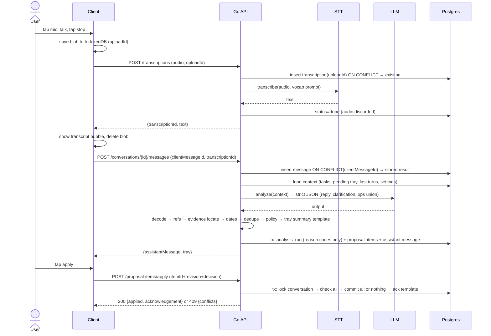

# Architecture & AI Pipeline

Status: Planning, rev 3 · Last updated 2026-11-22 · Generated from [plan.md](plan.md); edit plan.md first, then re-split.

Section numbers match `plan.md` (rev 3, the source). Where each section lives: Part A, §1–§4, §10 → product-requirements.md · §5–§7, §11 → architecture-and-ai-pipeline.md · §8–§9 → data-and-api.md · §12–§14, §16 → roadmap-and-testing.md · §15 → decisions.md

---

## 5. Technology stack

### 5.1 Fixed choices

| Layer | Choice | Why |
|---|---|---|
| Frontend | Next.js (App Router, current stable), TypeScript, Tailwind, shadcn/ui, Motion | Preference. Mostly client components. |
| Client state | TanStack Query, plus a reducer state machine for the recorder | No global store. |
| API contract | `api/openapi.yaml` (spec-first) → `openapi-typescript` client | One source for the contract. |
| Same-origin | Next.js rewrites `/api/*` to the Go backend | First-party cookies, no CORS, no proxy. |
| PWA | Manifest + Serwist (app-shell cache only) | Offline is V1. |
| DB | PostgreSQL 17 (managed) + `pg_trgm` | Dedupe scoring. No vector DB. |
| Real-time | None. Two HTTP steps (transcribe, then analyze) | SSE in V1. |
| Logging | Go `log/slog` JSON with redaction. `latency_ms`/`tokens`/`cost_usd` columns. | OpenTelemetry is V1 hardening. |
| Local dev | Docker Compose for Postgres. It is also used by the P0 eval runner for trigram scoring. | |
| STT bake-off | Throwaway Python script, `spikes/stt-bakeoff/` with `jiwer` | Output feeds the Go eval runner. |

**Not used:** Redis, queues, a vector DB, microservices, or agent frameworks.

### 5.2 Backend: Go (D-01, decided)

| Concern | Choice |
|---|---|
| Language | Go (current stable) |
| HTTP | `net/http` with Go 1.22+ pattern routing by default. Switch to `chi` only if middleware grouping gets awkward (decided in P1). |
| DB access | `pgx` v5 + `sqlc` (type-safe queries from SQL files) |
| Migrations | `goose` (SQL migrations) |
| Local dates | A small `civil.Date` type (`cloud.google.com/go/civil` or our own), `time.LoadLocation` with an embedded `time/tzdata` |
| Sessions | `alexedwards/scs` with a Postgres store, and `golang.org/x/crypto/bcrypt` for the seeded passwords |
| LLM SDK | The official Go SDK of the chosen vendor, behind our `TurnAnalyzer` interface |
| JSON Schema | Strict schema sent to the provider, re-validated server-side with `santhosh-tekuri/jsonschema`. Then a typed decode into Go structs per op type. |
| OpenAPI server | Spec-first. `oapi-codegen` for request and response types, and optionally stubs. Handlers are hand-written. |
| Rate limits | `golang.org/x/time/rate`, per user, in memory |
| Tests | `testing` with table tests, plus `testcontainers-go` for Postgres |

**Layout:**

```
cmd/api/                 HTTP server main
cmd/eval/                eval runner
internal/domain/         pure: dates, normalize, evidence, dedupe, policy, lifecycle, validate, templates
internal/app/            use cases: Transcribe, AnalyzeTurn, ApplyProposals, Tasks
internal/store/          sqlc-generated queries + pgx transactions
internal/ai/             Transcriber + TurnAnalyzer adapters
internal/httpapi/        handlers, session, limits
db/migrations/           goose
db/queries/              sqlc .sql
api/openapi.yaml
prompts/turn-analyzer/v1.md
eval/golden/{dev,heldout}/
web/                     Next.js app
spikes/stt-bakeoff/      throwaway Python
```

**Purity boundary:** `domain` does no I/O. Trigram scores come from Postgres (`store`), and `domain` makes the decision from those scores, the dates, and the numbers.

### 5.3 Speech-to-text: bake-off, then one adapter

| Candidate | Why it's in the bake-off |
|---|---|
| OpenAI `gpt-4o-transcribe` / `-mini-transcribe` | Strong multilingual support, prompt biasing |
| Groq-hosted Whisper large-v3 / turbo | Fastest and cheapest, prompt biasing |
| ElevenLabs Scribe | Reported strong on Arabic dialects |
| Google Chirp `ar-EG` (optional) | Dialect locale |
| Self-hosted faster-whisper | Not in the bake-off. V2, only if privacy or cost demands it. |

**Method:**
1. The Python script sends our 20 clips to each candidate. It records WER/CER, entity accuracy (names, English terms, numbers), latency, and cost per minute. It writes `transcripts/<provider>.json`.
2. The Go eval runner computes **downstream task F1** per provider from those files. The winner is chosen on downstream F1 first.
3. Only the winner gets a Go `Transcriber` adapter (P3).
4. Calls are biased with a short prompt of open task titles and names.

### 5.4 LLM

The choice is provider-agnostic. Requirements: strict JSON-schema output with `anyOf` support (for the op union), strong Egyptian Arabic, prompt caching, and no-training terms.

- **Build one adapter.** A second is built only if the first misses the gate after 2 prompt iterations.
- **Pin the model ID.** Any change to the model or prompt needs a passing eval on both splits.

---

## 6. High-level architecture




Two HTTP steps let the transcript show in 1–3 s, with a chance to fix it. Each step can be retried on its own.

---

## 7. AI conversation & task extraction

### 7.1 Design stance

**One call per turn.** One structured turn-analysis call per user message returns the reply, a nullable clarification, and typed ops. Deterministic code decides what reaches the user.

**Templates around the reply:** The server, not the model, writes:
- the tray summary, such as "اقترحتلك ٤ حاجات، راجعها وأكد"
- the date line between 00:00 and 04:00
- the post-apply acknowledgement

That way, no count or persistence claim can come from the model. If evaluation shows reply generation hurting extraction, the call is split behind the same interface.

### 7.2 Context sent to the model

- **System prompt:** `prompts/turn-analyzer/v1.md`. It holds the rules, op semantics, splitting rules, language policy, and 6–10 few-shot examples that never overlap the golden set.
  - Prompt rules:
    - Write numbers in titles as digits.
    - Write titles in the language the user spoke, keeping English technical terms in Latin script as spoken.
    - The reply must not mention counts, must not claim anything was saved or added, and must not repeat the clarification question.
- **Clock block:** Timezone, local now, logical today and tomorrow with Arabic and English weekday names, and week start.
- **Tasks:** Open tasks from logical today −1 to +14 days, plus Later. They are trigram-filtered if there are more than 40, and aliased `T1..Tn`. The model never sees UUIDs.
- **Pending tray:** Items aliased `P1..Pn`, with fields and the open clarification question.
- **Conversation:** The last 10 turns. User messages are labelled `U-0` (current), `U-1`, `U-2`, and so on.
- **Current message:** The text, and whether it came from voice or text.

### 7.3 Output schema: a discriminated union (illustrative)

Top level:

```json
{
  "reply": "string (user's language, ≤ 600 chars, suggestion language only)",
  "clarification": null,
  "operations": [ "<one of the op variants below>" ]
}
```

`clarification` is either `null` or `{ "question": "string", "about": ["P5"] }`. It is **not an op**. Its `about` field may name pending items or `op_id`s from this output.

Shared op fields: `op_id`, `type` (the discriminator), `evidence: [{ "message": "U-0|U-1|U-2", "quote": "verbatim span" }]`, and `confidence` (0–1). **The model never returns offsets.** Every variant sets `additionalProperties: false`.

| `type` | Required | Optional |
|---|---|---|
| `create` | `title`, `date` (DateExpr), `commitment` (definite\|tentative\|aspiration) | `description`, `deadline` (DateExpr), `priority`, `estimate_minutes` + `estimate_source` (stated\|inferred), `duplicate_of` (T#\|P#) |
| `update_task` | `target` (T#), and at least one of `set` / `clear` | `set: {title?, description?, priority?, estimate_minutes?, deadline?}`, `clear: ["description" \| "estimate_minutes" \| "deadline"]` |
| `reschedule_task` | `target` (T#), `date` (DateExpr, `later` allowed) | |
| `complete_task` | `target` (T#) | |
| `cancel_task` | `target` (T#) | |
| `revise_proposal` | `target` (P#), and at least one of `set` / `clear` | `set: {title?, description?, date?, deadline?, priority?, estimate_minutes?, commitment?}`, `clear: [...]` |
| `withdraw_proposal` | `target` (P#) | |

**`set`/`clear` semantics:**
- A field that is **absent from both is unchanged**. Omission never clears a field.
- A field may not appear in both.
- `update_task` cannot change the date. Date changes go through `reschedule_task`.

**DateExpr:** `{ "kind": "relative_day", "offset": 1 }` | `{ "kind": "weekday", "weekday": "thu", "which": "this|next|nearest" }` | `{ "kind": "absolute", "month": 12, "day": 5, "year": null }` | `{ "kind": "later" }` | `{ "kind": "unresolved", "text": "الأسبوع الجاي" }`.

The schema is sent to the provider as `anyOf` variants with a `const` discriminator. The server re-validates it, then decodes into one Go struct per variant.

### 7.4 Classification rules (in prompt, verified by eval)

- **Context** ("عندي امتحان بكرة"): no op. The reply may offer help.
- **Commitment with an action** ("لازم / المفروض / هعمل / محتاج أ…"): `create`, definite.
- **Tentative** ("ممكن / لو لقيت وقت / بفكر"): `create`, tentative. It goes to Maybe.
- **Aspiration** ("نفسي / عايز في يوم"): `create` with `aspiration`, but only if there is a concrete action. Otherwise the reply mentions it and no op is emitted.
- **Emotion:** never an op.
- **Negation plus a new date:** `reschedule_task`. **Negation alone:** `cancel_task`. **Past completion:** `complete_task`.
- **Correction** ("لا قصدي…"): `revise_proposal` on a pending item, or `update_task` on an applied one.
- **Clarification answer** ("خليها الخميس"): `revise_proposal` on the item the question was about. It sets the date and changes commitment to definite. If that item was already applied, it is `reschedule_task` instead.
- **Unsure which task is meant:** emit a `clarification` and no op for that target. Never guess.
- **Enumerable counts** ("محاضرتين"): N creates when N ≤ 5, numbered with digits.
- **Estimates:** `stated` only if the user said a duration. `inferred` is shown with "~".

### 7.5 Deterministic validation pipeline (server)

1. **Schema validation and typed decode.** Unknown properties, invalid combinations, or a field in both `set` and `clear` cause the op to be dropped with a reason code.
2. **Reference resolution.** Aliases map to real IDs from this request's context snapshot. If the target is unknown, or of the wrong kind (T vs P), the op is dropped with reason code `bad_target`. Ops named in `clarification.about` are not shown.
3. **Evidence location (the server computes offsets).**
   - Each evidence entry must name `U-0`, `U-1`, or `U-2`.
   - The server normalizes the quote and that message (§7.7). It looks for an exact substring first, then a best approximate-substring match (edit-distance ratio ≥ 0.8).
   - A found span is mapped back through the normalization offset map, giving original-text **code-point offsets** `{message_id, message_revision, start, end}`.
   - At least one entry must be located, or the op is dropped (reason code `evidence_not_found`).
   - The **displayed quote is always the original message substring at those offsets**, never the model's quote text.
   - **Re-proposal guard:** A `create` whose located evidence is *only* in `U-1`/`U-2` is checked against **every item that came from those messages, whatever its status**: pending, applied, **rejected**, **withdrawn**, or superseded. The check is title match only (§7.5.1 score ≥ 0.84 AND numbersMatch), ignoring dates. A match drops the op with reason code `reproposal_of_earlier_item` and shows no notice.
4. **Date resolution** (§7.6). A past date for `create`/`reschedule` leads to a clarification. A date more than 365 days out is flagged. `unresolved` goes to Later with a clarification.
5. **Field sanity.** Title 2–120 chars. Estimate 5–600 min. Valid enums.
6. **Lifecycle rules.** No completing a cancelled task. No rescheduling a completed task.
7. **Dedupe** (§7.5.1): a create is checked against open tasks, pending items, and other items in the same run.
8. **Policy** (table below).
9. **Templates.** The tray summary and the night date line are built from the validated items.
10. **Persist atomically.** The run (with reason codes), the items, and the assistant message are written in one transaction. **No `raw_output` is stored.**

| Op | Condition | Tray presentation |
|---|---|---|
| create | definite + evidence located + date resolved + not duplicate + confidence ≥ 0.5 | Pre-checked |
| create | tentative / aspiration | "Maybe", unchecked |
| create | confidence < 0.5 (otherwise valid) | "Maybe", unchecked, low-confidence flag |
| reschedule / update / cancel / complete | target valid | Change row (before → after), pre-checked |
| any | referenced in `clarification.about` | Not shown. The question is shown instead. |
| revise / withdraw proposal | target pending | Applied to the tray item. Revision +1. Change highlighted. |

**Failure handling:**
- **LLM timeout or 5xx:** 1 retry with backoff.
- **Schema-invalid output:** 1 repair retry with the error codes attached.
- **Still failing:** The message is saved, the run is marked `failed`, and the user sees a templated "اتسجل كلامك بس معرفتش أرتبه، تحب أجرب تاني؟" with Retry. The analysis budget is 20 s.
- **STT failure:** 1 retry. The audio stays in IndexedDB, and the user can retry or type instead.

#### 7.5.1 Dedupe rule and measured threshold

**Score:** `s(a, b) = GREATEST(similarity(a,b), word_similarity(a,b), word_similarity(b,a))`. It is computed by pg_trgm on `title_normalized`. It is symmetric because either side can be the shorter title.

- **numbersMatch:** The multiset of digit tokens in the two normalized titles is equal. Titles with no digits on either side count as matching.
- **dateCompatible:** The dates are within ±1 day of each other, or either date is Later.

**A pair is a duplicate if** (`s ≥ 0.84` AND `dateCompatible` AND `numbersMatch`) **OR** (`duplicate_of` resolves AND `numbersMatch`). A number mismatch overrides the model's `duplicate_of`.

**Measured scores.** These come from PostgreSQL 17 (`postgres:17-alpine`) with pg_trgm, run on 2026-11-22, on titles normalized per §7.7.

| Pair | Expected | similarity | wsim a→b | wsim b→a | **s** |
|---|---|---|---|---|---|
| R1 "review os lecture 1" / "…lecture 2" | distinct (numbers) | 0.818 | 0.900 | 0.900 | 0.900 |
| R2 "review os lecture 4" / "…lecture ٤" (normalized → 4) | dup | 1.000 | 1.000 | 1.000 | 1.000 |
| R3 "reply to ahmed" / "reply to ahmed about the project" | dup | **0.484** | 1.000 | 0.484 | **1.000** |
| R4 "reply to ahmed" Tue / Sat | distinct (date) | 1.000 | 1.000 | 1.000 | 1.000 |
| R5 `duplicate_of` lecture 1 → lecture 2 | distinct (numbers) | 0.818 | 0.900 | 0.900 | 0.900 |
| N1 "reply to ahmed" / "reply to khaled" | distinct | 0.476 | 0.600 | 0.563 | 0.600 |
| N2 "deploy the backend" / "deploy the frontend" | distinct | 0.500 | 0.579 | 0.550 | 0.579 |
| N3 "review os lecture 1" / "review networks lecture 1" | distinct | 0.586 | 0.586 | 0.586 | 0.586 |
| N4 "call the bank" / "call ahmed" | distinct | 0.250 | 0.357 | 0.455 | 0.455 |
| N5 "finish the ai project section" / "start the ai project section" | distinct | 0.647 | 0.759 | 0.815 | **0.815** |
| P1 "finish ai project section" / "finish the ai project section" | dup | 0.862 | 0.862 | 0.862 | **0.862** |
| P2 "write unit tests" / "write unit tests for the backend" | dup | 0.531 | 1.000 | 0.531 | 1.000 |
| P3 "go to the gym" / "gym" | dup | 0.333 | 0.333 | 1.000 | 1.000 |
| P4 "review chapter 3" / "review chapter 3 before the exam" | dup | 0.515 | 1.000 | 0.515 | 1.000 |
| A1 "ارد علي احمد" / "ارد علي احمد بخصوص المشروع" | dup | 0.480 | 1.000 | 0.480 | 1.000 |
| A2 "ارد علي احمد" / "ارد علي خالد" | distinct | 0.471 | 0.667 | 0.615 | 0.667 |
| A3 "اراجع محاضره os 1" / "…os 2" | distinct (numbers) | 0.800 | 0.889 | 0.889 | 0.889 |
| A4 "ابدا اتعلم docker" / "اتعلم docker" | dup | 0.765 | 0.765 | 1.000 | 1.000 |
| A5 "اعمل deploy للباك اند" / "اعمل deploy للفرونت اند" | distinct | 0.630 | 0.667 | 0.630 | 0.667 |

**Threshold = 0.84.** The highest score among distinct pairs that don't differ in numbers or dates is 0.815 (N5). The lowest score among true duplicates is 0.862 (P1). The threshold sits between them. Plain `similarity()` at 0.55 would have failed R3, A1, P2, P3, and P4.

**Known limits:**
- **Thin margin.** The gap between the two scores is only 0.047.
- **Containment.** Any title fully contained in another scores 1.0. For example, "gym" vs "cancel gym membership" on the same day would be flagged as a duplicate.
- **Arabic trigrams depend on the database locale.** They worked in the test image. The P1 acceptance criteria re-run this table on the real managed Postgres.
- **Growing the fixture.** Every false merge or false split found in daily use is added to the fixture, and the threshold is re-tuned.

### 7.6 Date & timezone handling

- **Storage types:** `scheduled_date` and `deadline_date` are SQL `date` columns, which are local calendar days. `deadline_time` is optional. Instants are `timestamptz` in UTC.
- **Logical today:** `localNow.time < dayBoundary ? localNow.date − 1 : localNow.date`. The boundary defaults to 04:00, and the rule is kept on purpose.

**Resolver rules:**
- **`relative_day n`:** logicalToday + n. النهاردة is 0, بكرة is +1, بعد بكرة is +2.
- **`weekday X nearest/next`** ("الخميس الجاي"): the nearest X strictly after logicalToday. Said on a Thursday, it means the following Thursday.
- **`weekday X this`:** X in the current week, with weeks starting Saturday. If that day has passed, it becomes a clarification.
- **`absolute` with no year:** the next occurrence on or after today.
- **"الأسبوع الجاي" or "آخر الشهر":** `later`, plus a clarification.

**Display rules:**
- **Every resolved date is shown explicitly.**
- **Night line:** If the message was sent between 00:00 and the day boundary, every item resolved from a relative expression shows a server-templated line under its date. For example, at 00:45 on Tue 24 Nov: "بكرة = التلات 24 نوفمبر".

**Edge rules:**
- **Timezone change:** Tasks keep their calendar dates.
- **Offsets:** UTC offsets are never hard-coded. Egypt reinstated DST in 2023.

### 7.7 Arabic text normalization (`domain`)

- Strip tashkeel and tatweel.
- Map أ/إ/آ → ا, ى → ي, ة → ه.
- Convert Arabic-Indic digits to ASCII.
- Lowercase Latin text and collapse whitespace.
- Turn "الـ X" into "x".
- Extract digit tokens.
- Return an **offset map** from normalized positions to original code points, so evidence offsets refer to the original text.

### 7.8 Idempotency, concurrency & duplicate prevention

| Layer | Mechanism |
|---|---|
| Audio upload | Client `uploadId`, UNIQUE (user_id, upload_id). `ON CONFLICT` returns the existing row, or 202 if it is still processing. |
| Message send | Client `clientMessageId`, UNIQUE per user. A retry returns the stored messages and tray. There is no second analysis. |
| Analysis | UNIQUE (message_id, message_revision). Items are written only on success, in the same transaction. |
| Apply (all-or-nothing) | One transaction (see the steps after this table). |
| Message edit | Same conversation lock (step 1 below). Supersedes only items still `pending` (revision +1). Items applied by a transaction that won first are untouched. The new analysis sees them as `T#`. |
| Tray edit (`PATCH`) | Carries the item's `revision`. A stale value returns 409. A successful edit increments the revision. |
| Manual create | A client-generated task UUID. `INSERT … ON CONFLICT (id) DO NOTHING`. |
| Semantic | §7.5.1 dedupe plus the re-proposal guard. |

**Apply transaction steps:**
1. `SELECT … FROM conversations WHERE id=$1 FOR UPDATE`. This lock serializes the apply against message edits and other applies.
2. Load all referenced items.
3. Check every decision: the item is owned by the user, its status is `pending`, its revision equals the request revision, and the target task is still lifecycle-valid.
4. If **any** check fails: commit nothing, return 409 with item-level conflicts.
5. Otherwise, insert or update the tasks, write task_events, mark the items `applied`/`rejected`, insert the templated acknowledgement message, and commit.

**Retry rule:** A retried apply whose items are all already in exactly the requested final states, with matching revisions, returns the stored outcome with 200 (S19). Anything else returns 409.

**Exactly one winner:** Because apply and message edit both take the conversation lock first, one of them always commits first. The other then sees changed statuses or revisions and acts on what is actually there.

Concurrent manual edits to the same task are last-write-wins. If-Match is V1 hardening.

### 7.9 Memory model

| Layer | MVP | Later |
|---|---|---|
| Current conversation | Last 10 turns plus the pending tray | Rolling summary (V1) |
| Task history | Tasks plus task_events (field values only) | Insights such as "deferred 3×" (V1) |
| Preferences | Explicit settings | Learned preferences, confirmed by the user (V1) |
| Long-term memory | None | V2: opt-in, user-approved facts that can be viewed and deleted |

**Retention (the full MVP privacy scope):**
- **Retention setting:** 7 d / 30 d (the default) / forever / don't keep.
- **"Don't keep":** A message is purged once its items are resolved.
- **Deleting a conversation:** This deletes its messages, analysis runs, proposal items (including their evidence offsets), and transcriptions. It also sets `tasks.source_message_id` and `tasks.evidence_ref` to null.
- **Orphan transcriptions:** Uploads never attached to a message are purged after 24 h.
- **"Delete all my data":** This deletes conversations, tasks, and transcriptions.

---

## 11. AI reliability, privacy & security

**Reliability:**
- **Validation:** The §7.5 pipeline, with the model output decoded as a typed union.
- **Server templates:** All counts, persistence claims, and night date lines.
- **Versioning:** Model and prompt versions are pinned and recorded per run, and validation reason codes are recorded per op.
- **Eval gate:** Both splits must pass.
- **Retries:** 1 retry, plus 1 repair.

**Privacy (full MVP scope):**
- No audio is stored, and no `raw_output` is stored.
- A retention setting.
- Deleting a conversation removes its transcriptions, runs, proposal items, and evidence.
- Task events hold field values only.
- "Delete all my data".
- Providers are used under no-training terms.

**Security:**
- **Session:** HttpOnly, Secure, SameSite=Lax cookie on the same origin through Next.js rewrites.
- **CSRF:** SameSite plus a custom header.
- **Isolation:** Per-user scoping in every sqlc query, covered by tests.
- **Uploads:** MIME sniffing, 25 MB and 5 min limits.
- **Operations:** Secrets in the host secret store. Dependency audit (`govulncheck`, `npm audit`) in CI.
- **Model output:** Treated as untrusted data. It can only propose ops against the user's own aliases.

**Logging:**
- `slog` JSON with one correlation ID per turn.
- Transcripts and titles are redacted.
- Cost and latency are queryable from `transcriptions` and `analysis_runs`.
