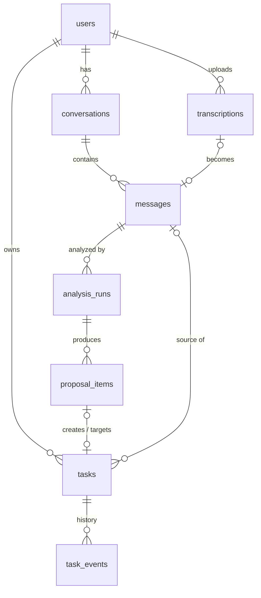
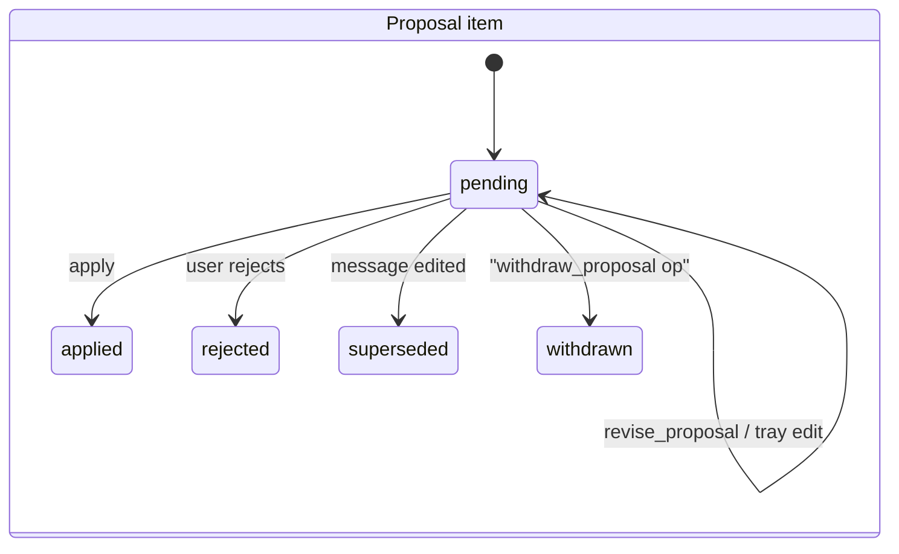
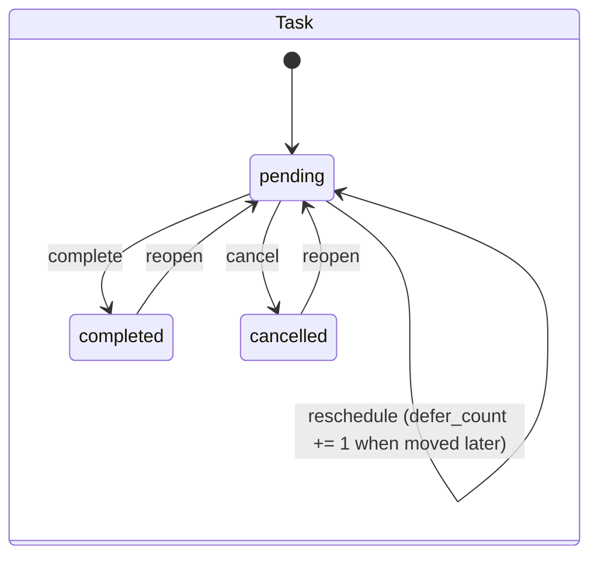

# Data Model & API Contract

Status: Approved for planning (rev 2) · Last updated 2026-11-22
Related: [product-requirements.md](product-requirements.md) · [architecture-and-ai-pipeline.md](architecture-and-ai-pipeline.md) · [roadmap-and-testing.md](roadmap-and-testing.md) · [decisions.md](decisions.md)

---

## 1. PostgreSQL database design



### 1.1 Tables

| Table | Key columns | Constraints / indexes |
|---|---|---|
| `users` (2 seeded rows) | id, email, password_hash, display_name, timezone (IANA), day_boundary = 04:00, week_start = sat, task_language (en\|ar\|match), daily_capacity_minutes = 360, transcript_retention (7d\|30d\|forever\|none) = 30d, monthly_audio_minutes_cap | unique email |
| `sessions` | id, user_id, expires_at | Only if the chosen stack's session library needs a DB store |
| `conversations` | id, user_id, started_at, last_message_at | idx (user_id, last_message_at desc) |
| `transcriptions` | id, user_id, upload_id, status (processing\|done\|failed), text, detected_language, duration_ms, provider, model, latency_ms, cost_usd, error_code, created_at | **unique (user_id, upload_id)** |
| `messages` | id, conversation_id, user_id, role (user\|assistant), text, input_mode (voice\|text), transcription_id, client_message_id, revision = 1, edited_at, created_at | **unique (user_id, client_message_id)** |
| `analysis_runs` | id, message_id, message_revision, status (succeeded\|failed\|partial), provider, model, prompt_version, raw_output jsonb (purged with the message), validation_report jsonb, attempts, tokens_in, tokens_out, latency_ms, cost_usd, created_at | **unique (message_id, message_revision)** |
| `proposal_items` | id, conversation_id, analysis_run_id, source_message_id, op_type, target_task_id, payload jsonb (title, dates, priority, estimate…), resolved_scheduled_date, commitment, presentation (preselected\|maybe\|change), low_confidence bool, evidence jsonb, confidence, duplicate_of_task_id, status (pending\|applied\|rejected\|superseded\|withdrawn), revision, clarification_question, decided_at, applied_task_id | idx (conversation_id, status) |
| `tasks` | id (client- or server-generated UUID), user_id, title, title_normalized, description, scheduled_date null (null = Later), status (pending\|completed\|cancelled), priority (high\|medium\|low), estimate_minutes, estimate_source (stated\|inferred\|manual), deadline_date, deadline_time, sort_order, source (manual\|ai), source_message_id (on delete set null), **source_proposal_item_id unique**, evidence, defer_count = 0, completed_at, cancelled_at, created_at, updated_at | idx (user_id, scheduled_date, status); GIN trgm (title_normalized) |
| `task_events` | id, task_id, user_id, type (created\|updated\|rescheduled\|completed\|reopened\|cancelled\|deleted), actor (user\|ai_confirmed), proposal_item_id, before jsonb, after jsonb, created_at | idx (task_id, created_at) |

### 1.2 Lifecycles





### 1.3 Data rules

- **Scoping.** Every query is scoped by `user_id`, and integration tests cover isolation.
- **Dates.** `scheduled_date` and `deadline_date` are local calendar days of type `date`. Instants are `timestamptz` in UTC.
- **Deletes.** Tasks are hard-deleted. A `deleted` event is kept, without content.
- **Purge job.** A daily in-process job purges expired transcripts and `raw_output`, following each user's retention setting. It uses a Postgres advisory lock, so no queue is needed.
- **Deleting a conversation.** This removes its messages, runs, and proposal items. It also sets `tasks.source_message_id` to null and clears `tasks.evidence`. The tasks themselves stay.
- **"Delete all my data".** This removes conversations, tasks, and transcriptions, and keeps the account.
- **Out of the MVP:**
  - V1 hardening: `invite_codes`, `idempotency_keys`, and row-version concurrency.
  - V1: `task_dependencies` and `parent_task_id`.
  - V2: `user_memories`.

---

## 2. Backend API contract (REST, `/api/v1`)

### 2.1 Conventions

- **Format:** JSON uses camelCase. Errors use RFC 9457 Problem Details with an extra `code` field.
- **Idempotency:** Client-generated IDs in request bodies make requests safe to retry: `uploadId`, `clientMessageId`, and the task `id`. There is no `Idempotency-Key` header.
- **Dates:** Dates are `YYYY-MM-DD`. Instants are ISO 8601 in UTC.
- **Contract:** The contract lives in `openapi.yaml`. TypeScript types are generated from it.
- **Same origin:** The browser calls `/api/*` on the Next.js origin, which rewrites the request to the backend.
- **Mutations:** Every mutating request must carry the custom CSRF header.

### 2.2 Endpoints

| Method & path | Purpose |
|---|---|
| `POST /auth/login` {email, password}, `POST /auth/logout` | Session cookie for the seeded accounts |
| `GET /me`, `PATCH /me/settings` | Profile and settings |
| `DELETE /me/data` | Delete all conversations and tasks, keeping the account |
| `POST /transcriptions` multipart {audio, uploadId} | Speech-to-text. Returns `{id, status, text, durationMs, language}`. A repeated `uploadId` returns the existing row. |
| `POST /conversations` | New session. The client starts one after 6 h of inactivity. |
| `GET /conversations`, `GET /conversations/{id}` | List, and detail with messages and the pending tray |
| `DELETE /conversations/{id}`, `DELETE /conversations` | Delete one, or all |
| `POST /conversations/{id}/messages` {clientMessageId, text?, transcriptionId?, inputMode} | Send a turn. Returns the reply and the tray. |
| `PUT /messages/{id}` {text} | Edit a message, re-analyze, and return the new tray |
| `POST /messages/{id}/retry-analysis` | Re-run a failed analysis |
| `PATCH /proposal-items/{id}` {title?, scheduledDate?, priority?, estimateMinutes?} | Edit an item before applying it |
| `POST /proposal-items/apply` {itemIds[], rejectItemIds[]} | Atomic apply. Returns `{applied:[{itemId, taskId, op}], skipped:[{itemId, reason}]}`. |
| `GET /days/{date}` | Tasks for the day, plus workload `{plannedMinutes, capacityMinutes, status}` and a carry-over count |
| `GET /tasks?from&to&status&later` | Range query |
| `POST /tasks` {id, title, scheduledDate?, priority?, estimateMinutes?, deadlineDate?} | Manual create. Idempotent on `id`. |
| `PATCH /tasks/{id}`, `DELETE /tasks/{id}` | Edit, delete. Concurrent edits are last-write-wins in the MVP. |
| `POST /tasks/{id}/complete` · `/reopen` · `/cancel` · `/reschedule` {toDate\|null} | Lifecycle actions. Each is idempotent on state. |
| `POST /tasks/move-unfinished` {fromDate, toDate\|null} | Batch roll-over |

### 2.3 Example: `POST /conversations/{id}/messages` response

```json
{
  "userMessage": { "id": "m_1", "text": "بص أنا النهاردة مخلصتش…", "revision": 1, "inputMode": "voice" },
  "assistantMessage": { "id": "m_2", "text": "باين يومك كان تقيل، ولا يهمك. حطيتلك ٤ حاجات لبكرة. وموضوع Docker، تحب نحطه بكرة ولا يوم تاني؟" },
  "analysis": { "runId": "r_1", "status": "succeeded" },
  "tray": {
    "items": [
      { "id": "p_1", "op": "create", "presentation": "preselected", "title": "Finish the AI project section",
        "scheduledDate": "2026-11-24", "priority": "high", "estimateMinutes": 120, "estimateSource": "inferred",
        "lowConfidence": false,
        "evidence": [{ "messageId": "m_1", "quote": "عندي جزء في مشروع الـ AI لازم أخلصه بكرة" }] },
      { "id": "p_5", "op": "create", "presentation": "maybe", "title": "Start learning Docker",
        "scheduledDate": null, "commitment": "tentative", "lowConfidence": false,
        "evidence": [{ "messageId": "m_1", "quote": "كنت عايز أبدأ أتعلم Docker بس مش عارف هلاقي وقت" }] }
    ],
    "notices": [],
    "clarification": { "question": "Docker: بكرة ولا يوم تاني؟", "itemIds": ["p_5"] },
    "workload": { "date": "2026-11-24", "plannedMinutes": 250, "capacityMinutes": 360, "status": "ok" }
  }
}
```

`notices` holds duplicate warnings, for example `{ "kind": "duplicate", "taskId": "…", "text": "Already on Tuesday: Reply to Ahmed" }`.

### 2.4 Error codes

| Code | Meaning |
|---|---|
| `stt_failed` | Transcription failed after retry. The client keeps the audio. |
| `stt_audio_too_long` | More than 5 min or 25 MB |
| `analysis_failed` | The LLM failed after retry and repair. The message is saved, and retry is available. |
| `limit_exceeded` | Request rate limit or monthly audio-minute cap |
| `item_not_pending` | Apply or edit was attempted on an item that is not pending |
| `validation_failed` | Request body invalid |
| `not_found` | Unknown or other-user resource |

### 2.5 Limits

- A per-user monthly audio-minute cap, stored in `users.monthly_audio_minutes_cap`.
- A simple per-minute request limit on `/transcriptions` and `/messages`.
- A provider-side monthly spend alert.
