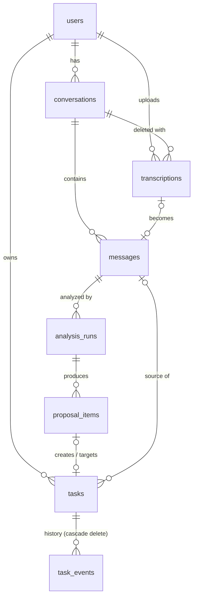

# Data Model & API Contract

Status: Planning, rev 3 · Last updated 2026-11-22 · Generated from [plan.md](plan.md); edit plan.md first, then re-split.

Section numbers match `plan.md` (rev 3, the source). Where each section lives: Part A, §1–§4, §10 → product-requirements.md · §5–§7, §11 → architecture-and-ai-pipeline.md · §8–§9 → data-and-api.md · §12–§14, §16 → roadmap-and-testing.md · §15 → decisions.md

---

## 8. PostgreSQL database design



| Table | Key columns | Constraints / indexes |
|---|---|---|
| `users` (2 seeded) | id, email, password_hash, display_name, timezone, day_boundary = 04:00, week_start = sat, task_language (spoken\|en\|ar) = spoken, daily_capacity_minutes = 360, transcript_retention = 30d, monthly_audio_minutes_cap | unique email |
| `sessions` | token, data, expiry | scs Postgres store schema |
| `conversations` | id, user_id, started_at, last_message_at | idx (user_id, last_message_at desc) |
| `transcriptions` | id, user_id, upload_id, conversation_id null (set when consumed; FK on delete cascade), status, text, detected_language, duration_ms, provider, model, latency_ms, cost_usd, error_code, created_at | **unique (user_id, upload_id)** |
| `messages` | id, conversation_id (cascade), user_id, role, kind (llm_reply\|template_ack\|template_error\|user), text, input_mode, transcription_id, client_message_id, revision, edited_at, created_at | **unique (user_id, client_message_id)** |
| `analysis_runs` | id, message_id (cascade), message_revision, status, provider, model, prompt_version, **validation_codes jsonb** (`[{op_index, code}]`, no text), attempts, tokens_in, tokens_out, latency_ms, cost_usd, created_at. **No raw_output.** | **unique (message_id, message_revision)** |
| `proposal_items` | id, user_id, conversation_id (cascade), analysis_run_id, source_message_id, op_type, target_task_id, payload jsonb (typed per op_type), resolved_scheduled_date, commitment, presentation (preselected\|maybe\|change), low_confidence, **evidence jsonb** (`[{message_id, message_revision, start, end}]`, offsets only), confidence, duplicate_of_task_id, duplicate_of_item_id, status (pending\|applied\|rejected\|superseded\|withdrawn), **revision** int, clarification_question, decided_at, applied_task_id | idx (conversation_id, status) |
| `tasks` | id (uuid, client or server), user_id, title, title_normalized, description, scheduled_date null (= Later), status (pending\|completed\|cancelled), priority, estimate_minutes, estimate_source, deadline_date, deadline_time, sort_order, source (manual\|ai), source_message_id (on delete set null), **source_proposal_item_id unique**, **evidence_ref jsonb** (offsets, rendered only while the message and revision exist), defer_count, completed_at, cancelled_at, created_at, updated_at | idx (user_id, scheduled_date, status); GIN trgm (title_normalized) |
| `task_events` | id, task_id (**FK on delete cascade**), user_id, type (created\|updated\|rescheduled\|completed\|reopened\|cancelled), actor (user\|ai_confirmed), proposal_item_id, **changes jsonb** (`{field: [before, after]}` for an allowlist: title, description, scheduled_date, status, priority, estimate_minutes, deadline_date, deadline_time. No evidence, no quotes.), created_at | idx (task_id, created_at) |

**Rules:**
- **Scoping:** Every query is scoped by `user_id`, both in the sqlc queries and in tests.
- **Task delete:** A hard delete that also removes its events through the cascade.
- **Purge job:** Runs daily in-process under a Postgres advisory lock. It purges expired messages and transcriptions per the retention setting, plus orphan transcriptions older than 24 h.
- **Not in the MVP:** `invite_codes`, `idempotency_keys`, and row-version columns (V1 hardening). Dependencies (V1). `user_memories` (V2).

---

## 9. Backend API contract (REST, `/api/v1`)

**Conventions:**
- **Format:** camelCase JSON. Errors use RFC 9457 Problem Details with a `code` field.
- **Idempotency:** Comes from client IDs (`uploadId`, `clientMessageId`, task `id`) and proposal `revision`.
- **Dates and times:** Dates are `YYYY-MM-DD`. Instants are UTC ISO.
- **Spec:** The contract lives in `api/openapi.yaml`.
- **CSRF:** Mutations require a custom CSRF header.

| Method & path | Purpose |
|---|---|
| `POST /auth/login`, `POST /auth/logout` | Session for the seeded accounts |
| `GET /me`, `PATCH /me/settings` | Profile and settings |
| `DELETE /me/data` | Delete all conversations, tasks, and transcriptions |
| `POST /transcriptions` multipart {audio, uploadId} | STT: `{id, status, text, durationMs, language}` |
| `POST /conversations` | New session (the client starts one after 6 h of inactivity) |
| `GET /conversations`, `GET /conversations/{id}` | List, and detail with messages and the pending tray |
| `DELETE /conversations/{id}`, `DELETE /conversations` | Delete one or all, including transcriptions, runs, and evidence |
| `POST /conversations/{id}/messages` {clientMessageId, text?, transcriptionId?, inputMode} | Turn: returns reply and tray |
| `PUT /messages/{id}` {text} | Edit: re-analyzes and returns a new tray (uses the conversation lock) |
| `POST /messages/{id}/retry-analysis` | Re-run a failed analysis |
| `PATCH /proposal-items/{id}` {revision, title?, scheduledDate?, priority?, estimateMinutes?} | Edit before apply. Returns 409 `stale_revision` if outdated. |
| `POST /proposal-items/apply` | All-or-nothing apply (below) |
| `GET /days/{date}` | Tasks for the day, workload, and carry-over count |
| `GET /tasks?from&to&status&later` | Range query |
| `POST /tasks` {id, title, scheduledDate?, priority?, estimateMinutes?, deadlineDate?} | Manual create, idempotent on `id` |
| `PATCH /tasks/{id}`, `DELETE /tasks/{id}` | Edit, or delete (also deletes the task's events) |
| `POST /tasks/{id}/complete` · `/reopen` · `/cancel` · `/reschedule` {toDate\|null} | Lifecycle, idempotent on state |
| `POST /tasks/move-unfinished` {fromDate, toDate\|null} | Batch roll-over |

**Apply request and responses:**

```json
POST /api/v1/proposal-items/apply
{ "conversationId": "c_1",
  "decisions": [
    { "itemId": "p_1", "revision": 1, "decision": "apply" },
    { "itemId": "p_2", "revision": 1, "decision": "apply" },
    { "itemId": "p_5", "revision": 2, "decision": "reject" } ] }

200 OK
{ "applied":  [ { "itemId": "p_1", "taskId": "t_9", "op": "create" },
                { "itemId": "p_2", "taskId": "t_10", "op": "create" } ],
  "rejected": [ "p_5" ],
  "acknowledgement": { "messageId": "m_7", "kind": "template_ack",
                       "text": "تمام، ضفت حاجتين لبكرة (التلات 24 نوفمبر)." } }

409 Conflict  (nothing committed)
{ "type": "about:blank", "title": "Apply conflict", "status": 409, "code": "apply_conflict",
  "conflicts": [ { "itemId": "p_2", "reason": "stale_revision", "currentRevision": 2 },
                 { "itemId": "p_5", "reason": "not_pending", "currentStatus": "superseded" } ] }
```

Conflict reasons: `stale_revision`, `not_pending`, `target_lifecycle_invalid`, `not_found`. There is no "skipped" outcome.

**Turn response for S1** (note the reply wording, the templated summary, and the server-cut evidence):

```json
{
  "userMessage": { "id": "m_1", "text": "بص أنا النهاردة مخلصتش…", "revision": 1, "inputMode": "voice" },
  "assistantMessage": { "id": "m_2", "kind": "llm_reply",
    "text": "باين يومك كان تقيل، ولا يهمك. رتبتلك اقتراحات لبكرة تحت، شوفها وعدّل اللي محتاج." },
  "analysis": { "runId": "r_1", "status": "succeeded" },
  "tray": {
    "summary": "اقترحتلك ٤ حاجات، راجعها وأكد",
    "items": [
      { "id": "p_1", "revision": 1, "op": "create", "presentation": "preselected",
        "title": "أخلص جزء مشروع الـ AI", "scheduledDate": "2026-11-24", "dateNote": null,
        "priority": "high", "estimateMinutes": 120, "estimateSource": "inferred", "lowConfidence": false,
        "evidence": [ { "messageId": "m_1", "quote": "عندي جزء في مشروع الـ AI لازم أخلصه بكرة" } ] },
      { "id": "p_5", "revision": 1, "op": "create", "presentation": "maybe",
        "title": "أبدأ أتعلم Docker", "scheduledDate": null, "commitment": "tentative", "lowConfidence": false,
        "evidence": [ { "messageId": "m_1", "quote": "كنت عايز أبدأ أتعلم Docker بس مش عارف هلاقي وقت" } ] }
    ],
    "notices": [],
    "clarification": { "question": "Docker: بكرة ولا يوم تاني؟", "itemIds": ["p_5"] },
    "workload": { "date": "2026-11-24", "plannedMinutes": 250, "capacityMinutes": 360, "status": "ok" }
  }
}
```

**Field notes:**
- **`summary`:** Counts pre-checked items. It is a server template.
- **`dateNote`:** Filled only between 00:00 and the day boundary, for example "بكرة = التلات 24 نوفمبر".
- **`evidence.quote`:** Cut by the server from `m_1` at the stored offsets.
- **`notices`:** Holds duplicate warnings such as "موجودة بالفعل يوم التلات: أرد على أحمد".

**Error codes:** `stt_failed`, `stt_audio_too_long`, `analysis_failed`, `limit_exceeded`, `apply_conflict`, `stale_revision`, `validation_failed`, `not_found`.

**Limits:** A per-user monthly audio-minute cap, and a per-minute request limit on the AI endpoints.
