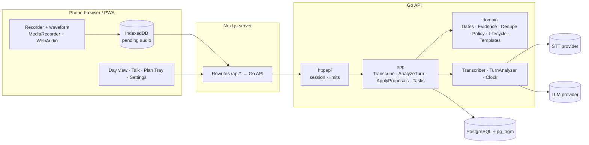
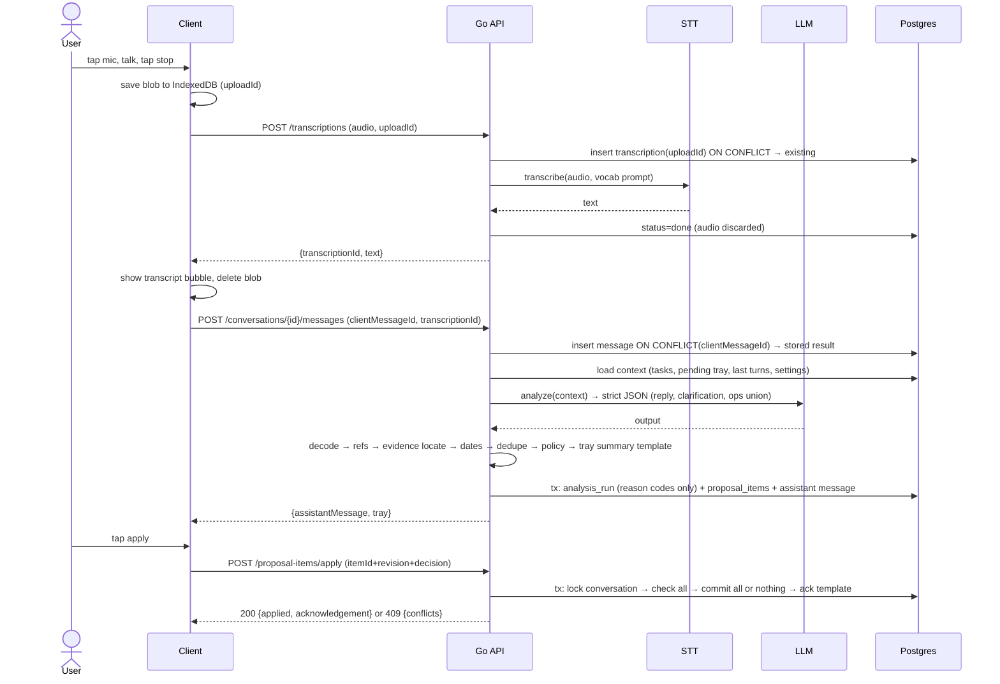
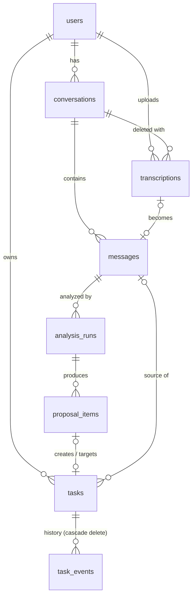
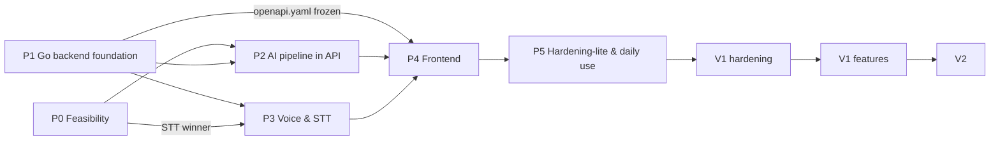

# Plan: AI Voice Companion & Intelligent To-Do Manager (rev 3)

Status: Planning, rev 3 · Last updated 2026-11-22 · This file is the source of truth. The four topic docs are generated splits of it, and `decisions.md` holds the ADRs.

## Context

- **What it does:** It is a voice-first, Egyptian-Arabic-capable companion. You talk through your day at night, and the app turns what you actually committed to into tomorrow's checklist.
- **Hard rules:** It must not invent tasks, and it must not mistake feelings or wishes for commitments.
- **Who it's for:** Two users, who are also the two builders. Both of us are students and work on it when we're free, about 2 h/day each on average.
- **Stage:** This is still planning. No application code, scaffolding, or dependency installs exist yet.
- **Example clock:** Scenarios assume "now" is **Monday 2026-11-23 22:30, Africa/Cairo** unless stated.

### Revision history

**Rev 2 (approved with 3 fixes, plus D-01):**
- **Dedupe:** It is number-aware and uses AND semantics.
- **Evidence:** It may come from any of the last 3 user messages.
- **Low confidence:** Items under 0.5 confidence go to "Maybe".
- **Scope:** It is sized for 2 users at 2 h/day.
- **Docs:** 4 docs plus `decisions.md`.
- **Fixes applied in rev 3:**
  1. **Trigram metric.** The dedupe score is now `GREATEST(similarity, word_similarity both ways)`. The 0.84 threshold was set from measured pg_trgm scores (§7.5.1).
  2. **Re-proposal guard.** A create cited only in earlier messages is also checked against **rejected and withdrawn** items (new scenario S30).
  3. **Held-out split.** At least 10 golden cases come from our real nights, recorded before prompt v1. They are reported as a held-out split, and the gate must pass on it (§12).
  4. **D-01 = Go**, using pgx + sqlc, goose, and net/http or chi.

**Rev 3 (from the Codex review of rev 1, `architecture-review.md`; accepted points only):**
1. **(C3)** Replies only ever *suggest* before apply. After apply, the acknowledgement is a server template built from the apply response.
2. **(H3)** Clarification is a separate nullable object, not an op. Model output is a discriminated union per op type, and `update_task` uses explicit `set`/`clear`.
3. **(H4, C4)** Apply is all-or-nothing and carries proposal revisions. A stale revision returns 409, and the item-level "skipped" response is gone. Apply and message-edit have exactly one winner per transaction.
4. **(H5)** Hard-deleting a task deletes its events. Events store task field names and values only.
5. **(H2)** The model returns a quote only. The server locates it and stores offsets.
6. **(C2, small)** `raw_output` is not stored, and only validation reason codes are kept. Deleting a conversation also deletes its transcriptions and proposal evidence.
7. **(M3)** D-04 default: titles are in the language the user spoke, with English technical terms kept as spoken.
8. **(H1)** The 04:00 rule stays. Between 00:00 and 04:00 the tray adds a date line.

The Codex findings we rejected are listed in `decisions.md`.

---

## Part A — Analysis before planning

### A.1 Refined core workflow

**Speak → Transcript (editable) → AI reply + suggested changes → One-tap confirm → Checklist → Check off / revise by talking.**

- The AI never writes to the task list. It emits **proposed operations**, which land in a **Plan Tray**.
- **Before apply:** The reply only describes *suggestions*. A server-templated tray summary reads, for example, "اقترحتلك ٤ حاجات، راجعها وأكد".
- **After apply:** A server-templated acknowledgement is built from what was actually committed.
- **Pre-checking:** Definite tasks are pre-checked. Tentative and low-confidence items are unchecked under "Maybe". Changes to existing tasks show as before → after rows.
- **Auto-apply:** An opt-in auto-apply is a V1 option once precision is at least 0.95.

### A.2 Where we pushed back on the brief

| Brief said | Concern | Decision |
|---|---|---|
| AI "automatically organizes" tasks | Silent auto-creation with a sometimes-wrong model destroys trust | Suggestions with one-tap confirm. V1 opt-in auto-apply. |
| 6 primary screens | Today Dashboard and Daily Checklist are the same screen, and Tomorrow is the same view | 3 surfaces: Day view, Talk, Settings & Privacy |
| "Deferred" status | A task moved to Friday is pending on Friday | `pending` / `completed` / `cancelled`, a `rescheduled` event, `defer_count`, null date = Later |
| Heavy Clean Architecture / microservices | Ceremony without payoff at 2 users | A lean Go modular monolith with a pure domain package |
| Streaming STT, TTS, live voice | Large complexity for a nightly monologue | Batch STT and a local waveform. Streaming and TTS in V1/V2. |
| LLM computes dates | Weekday arithmetic errors at midnight and DST | The LLM emits a date expression, and a deterministic resolver turns it into a date |
| LLM confidence decides creation | Poorly calibrated | Policy decides. Confidence only demotes an item to Maybe. |
| LLM reports what it saved | A generative reply can't know a later transaction's result | Suggestion language only. Acknowledgement templated from the apply response. |

### A.3 Hardest technical challenges, ranked

1. **Egyptian Arabic + English code-switching STT.** It can translate, transliterate ("دوكر"), drop terms, or confuse names (أحمد/أمجد).
2. **Commitment classification.** The model has to tell context, task, aspiration, and emotion apart.
3. **Reference resolution.** "خليها الجمعة", "قصدي محاضرة 4", "الغي الجيم", and answers to the app's own questions.
4. **Night-time date boundary.** At 00:45 Tuesday, "بكرة" = Tuesday under the 04:00 rule.
5. **Exactly-once creation under retries.** It must also hold when an apply races a message edit.
6. **Mobile web audio.** iOS Safari MediaRecorder, PWA mic permission, and screen lock.

### A.4 Assumptions

1. **Users:** There are exactly 2 seeded accounts and no registration.
2. **Capacity:** About 2 h/day each, but we work when we're free. **Hour estimates are the real estimate. Calendar weeks are rough.**
3. **Language:** The UI is English with full RTL/bidi for Arabic content. Arabic UI is V1 (D-05).
4. **Task titles:** Titles are **in the language the user spoke**, keeping English technical terms as spoken (D-04). Titles stay editable.
5. **Replies:** The assistant mirrors the user's language. Egyptian Arabic in means Egyptian Arabic out.
6. **Days and weeks:** The day boundary is 04:00 local. Weeks start Saturday. We are the users, so there is no external validation of the boundary convention.
7. **Hosting:** A single cheap host plus managed Postgres, in an EU region (D-08).
8. **Audio:** Never stored server-side beyond transcription.

---

## 1. Product vision

**Vision:** "Talk it out at night, wake up to a plan you trust."

**Positioning:** You capture tasks by talking naturally in your own dialect. The AI acts as a **careful secretary**. It suggests only commitments, asks when unsure, and shows the words it relied on.

**Principles:**
1. **Never invent.** Every AI suggestion cites the user's own words, located by the server.
2. **Never silent, never overclaiming.** Every change is visible. The AI never says something was saved unless the server committed it.
3. **Feelings are heard, not filed.**
4. **Tomorrow should be doable.** The app warns on overload.
5. **Private by default.**

**Core KPIs:** nightly sessions per week, tray acceptance rate, edits after apply, next-day completion rate.

## 2. Personas & core journeys

**Personas:**
- **Primary (real users), the two of us:** CS students in Egypt with lectures, a project, and side learning. We speak Egyptian Arabic with English technical terms and plan at night on a phone.
- **Future (informs design only):** A freelancer or junior developer who captures follow-ups by text, and an Arabic-first professional who dislikes typing.

**Journeys:**
1. **J1 Nightly brain-dump.** Tap the mic and talk for 1–3 minutes. The transcript appears. The reply comes with a tray showing "اقترحتلك ٤ حاجات، راجعها وأكد". Answer the Docker question, tap apply, and see the ack "تمام، ضفت ٤ حاجات لبكرة".
2. **J2 Morning check.** The Today view shows progress, and you tick tasks off.
3. **J3 Quick capture.** "فكرني أكلم البنك الخميس" becomes one suggestion, which you confirm.
4. **J4 Revise by talking.** "بكرة مش هعمل Docker، خليها الجمعة" shows a "Tue → Fri" change row, which you confirm.
5. **J5 Roll over.** Yesterday's unfinished tasks move to today or Later.
6. **J6 Privacy.** Deleting a conversation also deletes its transcriptions and evidence. The tasks remain.

## 3. MVP scope & explicit non-goals

**MVP goal:** Prove that an Egyptian Arabic or code-switched conversation reliably becomes the correct next-day checklist, end to end, on our phones.

**In MVP:**
- **Accounts:** 2 seeded accounts with password login. Settings cover timezone, day boundary, task-title language, and daily capacity.
- **Recording:** Visible states, a local waveform, a 5-minute cap, and crash-safe local buffering.
- **Input:** Batch STT through **one** adapter (the bake-off winner). Text input is on par with voice.
- **Conversation:** Full history. Editing a sent message re-runs analysis.
- **Turn analyzer:** **One** LLM adapter. It returns a reply, a nullable **clarification object**, and typed ops: `create`, `update_task`, `reschedule_task`, `complete_task`, `cancel_task`, `revise_proposal`, `withdraw_proposal`.
- **Deterministic core:** The validator, evidence locator, date resolver, number-aware dedupe, and policy.
- **Plan Tray:** A templated summary, pre-checked and Maybe items, inline edit, and **all-or-nothing** one-tap apply with a templated acknowledgement.
- **Day view:** Today, Tomorrow, or any date. Checkbox, undo, edit, reschedule, delete, manual add, a workload bar, and "move unfinished".
- **Privacy (full MVP scope):** A retention setting. Deleting a conversation also deletes its transcriptions, runs, and proposal evidence. "Delete all my data". No `raw_output` stored.
- **Quality and ops:** An evaluation harness with dev and held-out splits. Structured logs, plus per-run `cost_usd` and latency.
- **Shell:** An installable PWA shell, online only.

**Non-goals:** Everything below is out of the MVP.
- **Voice:** Streaming STT and TTS.
- **Memory:** Long-term memory.
- **Task features:** Subtasks, recurrence, reminders, calendar sync, and time-blocking.
- **Platform:** Offline editing, sharing, native apps, and Arabic UI chrome.
- **Automation:** Auto-apply.
- **Infrastructure:** Redis, queues, SignalR, a vector DB, and agents.
- **Hardening:** Everything on the V1 hardening list (§13.1).

**Anti-goals:** A cluttered dashboard. A chatbot that turns every sentence into a task. A therapist persona. Stored voice recordings.

## 4. Requirements

### 4.1 Functional (MVP)

| ID | Requirement |
|---|---|
| FR-01 | **Recording:** Record voice with visible state and elapsed time. Auto-stop at 5 min, with a warning at 4:30. |
| FR-02 | **Local buffering:** A recording stays on the device until its transcript is saved. Failed uploads can be retried. |
| FR-03 | **Editable transcript:** The transcript appears as the user's message. Editing it re-runs analysis and supersedes that message's still-pending items. Apply and edit race safely (FR-18). |
| FR-04 | **Text input:** Text runs the same pipeline as voice. |
| FR-05 | **Reply rules:** The reply is in the user's language. **Before apply it describes suggestions only.** It never states counts and never claims anything was saved. It asks at most one clarifying question per turn, through the clarification object. |
| FR-06 | **Pre-check and Maybe:** Definite creates are pre-checked. Tentative items, concrete aspirations, and confidence < 0.5 go to unchecked "Maybe", with a low-confidence flag where it applies. |
| FR-07 | **Evidence display:** Every suggestion shows its resolved date and an expandable evidence quote. The **server cuts the quote from the message text using offsets it computed itself**. Between 00:00 and the day boundary, relative-date items show a line such as "بكرة = التلات 24 نوفمبر". |
| FR-08 | **Tray editing:** Items can be edited in the tray, and each edit bumps the item's revision. Apply is **all-or-nothing**. Any conflict commits nothing and shows item-level conflicts. |
| FR-09 | **Existing tasks:** References to existing tasks become modify ops, never duplicate creates. |
| FR-10 | **Corrections:** Corrections and clarification answers revise pending items rather than adding new ones. |
| FR-11 | **Dedupe:** Number-aware dedupe (§7.5.1) shows "already on your list" and blocks the insert. Re-proposals of rejected or withdrawn items from earlier messages are dropped. |
| FR-12 | **Day view actions:** Checkbox, undo, edit, reschedule, delete, manual add. |
| FR-13 | **Workload:** A workload bar compares estimates with daily capacity. |
| FR-14 | **Move unfinished:** A past day's pending tasks move to today or Later. |
| FR-15 | **Date resolution:** Dates resolve in the user's IANA timezone with the day boundary. |
| FR-16 | **Privacy settings:** A retention setting. Deleting a conversation removes its messages, transcriptions, runs, proposal items, and evidence. "Delete all my data". |
| FR-17 | **Acknowledgement:** After apply, the assistant acknowledgement is a **server template** built from the apply response, never from LLM output. |
| FR-18 | **Apply vs edit race:** When apply and message-edit act on the same proposal, exactly one wins inside its transaction. The loser gets a 409 or a no-op result. |

### 4.2 Non-functional

| Area | Target |
|---|---|
| Latency | Stop on a 60 s clip until the tray shows: p50 ≤ 5 s, p95 ≤ 10 s. Text to tray: p50 ≤ 3 s. Toggle: ≤ 150 ms with an optimistic update. |
| Quality | The §12.2 gate on **both** the dev and held-out splits. It is directional at this size. |
| Reliability | Zero duplicate tasks from retries (hard requirement). Zero partial applies. No recording lost silently. |
| Privacy | No audio retained. No `raw_output`. Transcripts kept per the retention setting, 30 days by default. No transcripts in logs. Providers under no-training API terms. |
| Security | Per-user isolation, tested. HttpOnly session cookie. Upload limits. A spend cap. ASVS is a guideline in the MVP and a V1-hardening gate. |
| Accessibility | A labelled mic, reduced motion, RTL-correct layout. WCAG AA is a guideline in the MVP and a V1-hardening gate. |
| Mobile | Installable PWA on Chrome Android and iOS Safari 17+. |
| Cost | `cost_usd` per call, a provider spend alert, and a per-user monthly audio-minute cap. |
| Portability | STT and LLM sit behind interfaces. Re-evaluate on any swap. |

## 5. Technology stack

### 5.1 Fixed choices

| Layer | Choice | Why |
|---|---|---|
| Frontend | Next.js (App Router, current stable), TypeScript, Tailwind, shadcn/ui, Motion | Preference. Mostly client components. |
| Client state | TanStack Query, plus a reducer state machine for the recorder | No global store. |
| API contract | `api/openapi.yaml` (spec-first) → `openapi-typescript` client | One source for the contract. |
| Same-origin | Next.js rewrites `/api/*` to the Go backend | First-party cookies, no CORS, no proxy. |
| PWA | Manifest + Serwist (app-shell cache only) | Offline is V1. |
| DB | PostgreSQL 17 (managed) + `pg_trgm` | Dedupe scoring. No vector DB. |
| Real-time | None. Two HTTP steps (transcribe, then analyze) | SSE in V1. |
| Logging | Go `log/slog` JSON with redaction. `latency_ms`/`tokens`/`cost_usd` columns. | OpenTelemetry is V1 hardening. |
| Local dev | Docker Compose for Postgres. It is also used by the P0 eval runner for trigram scoring. | |
| STT bake-off | Throwaway Python script, `spikes/stt-bakeoff/` with `jiwer` | Output feeds the Go eval runner. |

**Not used:** Redis, queues, a vector DB, microservices, or agent frameworks.

### 5.2 Backend: Go (D-01, decided)

| Concern | Choice |
|---|---|
| Language | Go (current stable) |
| HTTP | `net/http` with Go 1.22+ pattern routing by default. Switch to `chi` only if middleware grouping gets awkward (decided in P1). |
| DB access | `pgx` v5 + `sqlc` (type-safe queries from SQL files) |
| Migrations | `goose` (SQL migrations) |
| Local dates | A small `civil.Date` type (`cloud.google.com/go/civil` or our own), `time.LoadLocation` with an embedded `time/tzdata` |
| Sessions | `alexedwards/scs` with a Postgres store, and `golang.org/x/crypto/bcrypt` for the seeded passwords |
| LLM SDK | The official Go SDK of the chosen vendor, behind our `TurnAnalyzer` interface |
| JSON Schema | Strict schema sent to the provider, re-validated server-side with `santhosh-tekuri/jsonschema`. Then a typed decode into Go structs per op type. |
| OpenAPI server | Spec-first. `oapi-codegen` for request and response types, and optionally stubs. Handlers are hand-written. |
| Rate limits | `golang.org/x/time/rate`, per user, in memory |
| Tests | `testing` with table tests, plus `testcontainers-go` for Postgres |

**Layout:**

```
cmd/api/                 HTTP server main
cmd/eval/                eval runner
internal/domain/         pure: dates, normalize, evidence, dedupe, policy, lifecycle, validate, templates
internal/app/            use cases: Transcribe, AnalyzeTurn, ApplyProposals, Tasks
internal/store/          sqlc-generated queries + pgx transactions
internal/ai/             Transcriber + TurnAnalyzer adapters
internal/httpapi/        handlers, session, limits
db/migrations/           goose
db/queries/              sqlc .sql
api/openapi.yaml
prompts/turn-analyzer/v1.md
eval/golden/{dev,heldout}/
web/                     Next.js app
spikes/stt-bakeoff/      throwaway Python
```

**Purity boundary:** `domain` does no I/O. Trigram scores come from Postgres (`store`), and `domain` makes the decision from those scores, the dates, and the numbers.

### 5.3 Speech-to-text: bake-off, then one adapter

| Candidate | Why it's in the bake-off |
|---|---|
| OpenAI `gpt-4o-transcribe` / `-mini-transcribe` | Strong multilingual support, prompt biasing |
| Groq-hosted Whisper large-v3 / turbo | Fastest and cheapest, prompt biasing |
| ElevenLabs Scribe | Reported strong on Arabic dialects |
| Google Chirp `ar-EG` (optional) | Dialect locale |
| Self-hosted faster-whisper | Not in the bake-off. V2, only if privacy or cost demands it. |

**Method:**
1. The Python script sends our 20 clips to each candidate. It records WER/CER, entity accuracy (names, English terms, numbers), latency, and cost per minute. It writes `transcripts/<provider>.json`.
2. The Go eval runner computes **downstream task F1** per provider from those files. The winner is chosen on downstream F1 first.
3. Only the winner gets a Go `Transcriber` adapter (P3).
4. Calls are biased with a short prompt of open task titles and names.

### 5.4 LLM

The choice is provider-agnostic. Requirements: strict JSON-schema output with `anyOf` support (for the op union), strong Egyptian Arabic, prompt caching, and no-training terms.

- **Build one adapter.** A second is built only if the first misses the gate after 2 prompt iterations.
- **Pin the model ID.** Any change to the model or prompt needs a passing eval on both splits.

## 6. High-level architecture





Two HTTP steps let the transcript show in 1–3 s, with a chance to fix it. Each step can be retried on its own.

## 7. AI conversation & task extraction

### 7.1 Design stance

**One call per turn.** One structured turn-analysis call per user message returns the reply, a nullable clarification, and typed ops. Deterministic code decides what reaches the user.

**Templates around the reply:** The server, not the model, writes:
- the tray summary, such as "اقترحتلك ٤ حاجات، راجعها وأكد"
- the date line between 00:00 and 04:00
- the post-apply acknowledgement

That way, no count or persistence claim can come from the model. If evaluation shows reply generation hurting extraction, the call is split behind the same interface.

### 7.2 Context sent to the model

- **System prompt:** `prompts/turn-analyzer/v1.md`. It holds the rules, op semantics, splitting rules, language policy, and 6–10 few-shot examples that never overlap the golden set.
  - Prompt rules:
    - Write numbers in titles as digits.
    - Write titles in the language the user spoke, keeping English technical terms in Latin script as spoken.
    - The reply must not mention counts, must not claim anything was saved or added, and must not repeat the clarification question.
- **Clock block:** Timezone, local now, logical today and tomorrow with Arabic and English weekday names, and week start.
- **Tasks:** Open tasks from logical today −1 to +14 days, plus Later. They are trigram-filtered if there are more than 40, and aliased `T1..Tn`. The model never sees UUIDs.
- **Pending tray:** Items aliased `P1..Pn`, with fields and the open clarification question.
- **Conversation:** The last 10 turns. User messages are labelled `U-0` (current), `U-1`, `U-2`, and so on.
- **Current message:** The text, and whether it came from voice or text.

### 7.3 Output schema: a discriminated union (illustrative)

Top level:

```json
{
  "reply": "string (user's language, ≤ 600 chars, suggestion language only)",
  "clarification": null,
  "operations": [ "<one of the op variants below>" ]
}
```

`clarification` is either `null` or `{ "question": "string", "about": ["P5"] }`. It is **not an op**. Its `about` field may name pending items or `op_id`s from this output.

Shared op fields: `op_id`, `type` (the discriminator), `evidence: [{ "message": "U-0|U-1|U-2", "quote": "verbatim span" }]`, and `confidence` (0–1). **The model never returns offsets.** Every variant sets `additionalProperties: false`.

| `type` | Required | Optional |
|---|---|---|
| `create` | `title`, `date` (DateExpr), `commitment` (definite\|tentative\|aspiration) | `description`, `deadline` (DateExpr), `priority`, `estimate_minutes` + `estimate_source` (stated\|inferred), `duplicate_of` (T#\|P#) |
| `update_task` | `target` (T#), and at least one of `set` / `clear` | `set: {title?, description?, priority?, estimate_minutes?, deadline?}`, `clear: ["description" \| "estimate_minutes" \| "deadline"]` |
| `reschedule_task` | `target` (T#), `date` (DateExpr, `later` allowed) | |
| `complete_task` | `target` (T#) | |
| `cancel_task` | `target` (T#) | |
| `revise_proposal` | `target` (P#), and at least one of `set` / `clear` | `set: {title?, description?, date?, deadline?, priority?, estimate_minutes?, commitment?}`, `clear: [...]` |
| `withdraw_proposal` | `target` (P#) | |

**`set`/`clear` semantics:**
- A field that is **absent from both is unchanged**. Omission never clears a field.
- A field may not appear in both.
- `update_task` cannot change the date. Date changes go through `reschedule_task`.

**DateExpr:** `{ "kind": "relative_day", "offset": 1 }` | `{ "kind": "weekday", "weekday": "thu", "which": "this|next|nearest" }` | `{ "kind": "absolute", "month": 12, "day": 5, "year": null }` | `{ "kind": "later" }` | `{ "kind": "unresolved", "text": "الأسبوع الجاي" }`.

The schema is sent to the provider as `anyOf` variants with a `const` discriminator. The server re-validates it, then decodes into one Go struct per variant.

### 7.4 Classification rules (in prompt, verified by eval)

- **Context** ("عندي امتحان بكرة"): no op. The reply may offer help.
- **Commitment with an action** ("لازم / المفروض / هعمل / محتاج أ…"): `create`, definite.
- **Tentative** ("ممكن / لو لقيت وقت / بفكر"): `create`, tentative. It goes to Maybe.
- **Aspiration** ("نفسي / عايز في يوم"): `create` with `aspiration`, but only if there is a concrete action. Otherwise the reply mentions it and no op is emitted.
- **Emotion:** never an op.
- **Negation plus a new date:** `reschedule_task`. **Negation alone:** `cancel_task`. **Past completion:** `complete_task`.
- **Correction** ("لا قصدي…"): `revise_proposal` on a pending item, or `update_task` on an applied one.
- **Clarification answer** ("خليها الخميس"): `revise_proposal` on the item the question was about. It sets the date and changes commitment to definite. If that item was already applied, it is `reschedule_task` instead.
- **Unsure which task is meant:** emit a `clarification` and no op for that target. Never guess.
- **Enumerable counts** ("محاضرتين"): N creates when N ≤ 5, numbered with digits.
- **Estimates:** `stated` only if the user said a duration. `inferred` is shown with "~".

### 7.5 Deterministic validation pipeline (server)

1. **Schema validation and typed decode.** Unknown properties, invalid combinations, or a field in both `set` and `clear` cause the op to be dropped with a reason code.
2. **Reference resolution.** Aliases map to real IDs from this request's context snapshot. If the target is unknown, or of the wrong kind (T vs P), the op is dropped with reason code `bad_target`. Ops named in `clarification.about` are not shown.
3. **Evidence location (the server computes offsets).**
   - Each evidence entry must name `U-0`, `U-1`, or `U-2`.
   - The server normalizes the quote and that message (§7.7). It looks for an exact substring first, then a best approximate-substring match (edit-distance ratio ≥ 0.8).
   - A found span is mapped back through the normalization offset map, giving original-text **code-point offsets** `{message_id, message_revision, start, end}`.
   - At least one entry must be located, or the op is dropped (reason code `evidence_not_found`).
   - The **displayed quote is always the original message substring at those offsets**, never the model's quote text.
   - **Re-proposal guard:** A `create` whose located evidence is *only* in `U-1`/`U-2` is checked against **every item that came from those messages, whatever its status**: pending, applied, **rejected**, **withdrawn**, or superseded. The check is title match only (§7.5.1 score ≥ 0.84 AND numbersMatch), ignoring dates. A match drops the op with reason code `reproposal_of_earlier_item` and shows no notice.
4. **Date resolution** (§7.6). A past date for `create`/`reschedule` leads to a clarification. A date more than 365 days out is flagged. `unresolved` goes to Later with a clarification.
5. **Field sanity.** Title 2–120 chars. Estimate 5–600 min. Valid enums.
6. **Lifecycle rules.** No completing a cancelled task. No rescheduling a completed task.
7. **Dedupe** (§7.5.1): a create is checked against open tasks, pending items, and other items in the same run.
8. **Policy** (table below).
9. **Templates.** The tray summary and the night date line are built from the validated items.
10. **Persist atomically.** The run (with reason codes), the items, and the assistant message are written in one transaction. **No `raw_output` is stored.**

| Op | Condition | Tray presentation |
|---|---|---|
| create | definite + evidence located + date resolved + not duplicate + confidence ≥ 0.5 | Pre-checked |
| create | tentative / aspiration | "Maybe", unchecked |
| create | confidence < 0.5 (otherwise valid) | "Maybe", unchecked, low-confidence flag |
| reschedule / update / cancel / complete | target valid | Change row (before → after), pre-checked |
| any | referenced in `clarification.about` | Not shown. The question is shown instead. |
| revise / withdraw proposal | target pending | Applied to the tray item. Revision +1. Change highlighted. |

**Failure handling:**
- **LLM timeout or 5xx:** 1 retry with backoff.
- **Schema-invalid output:** 1 repair retry with the error codes attached.
- **Still failing:** The message is saved, the run is marked `failed`, and the user sees a templated "اتسجل كلامك بس معرفتش أرتبه، تحب أجرب تاني؟" with Retry. The analysis budget is 20 s.
- **STT failure:** 1 retry. The audio stays in IndexedDB, and the user can retry or type instead.

#### 7.5.1 Dedupe rule and measured threshold

**Score:** `s(a, b) = GREATEST(similarity(a,b), word_similarity(a,b), word_similarity(b,a))`. It is computed by pg_trgm on `title_normalized`. It is symmetric because either side can be the shorter title.

- **numbersMatch:** The multiset of digit tokens in the two normalized titles is equal. Titles with no digits on either side count as matching.
- **dateCompatible:** The dates are within ±1 day of each other, or either date is Later.

**A pair is a duplicate if** (`s ≥ 0.84` AND `dateCompatible` AND `numbersMatch`) **OR** (`duplicate_of` resolves AND `numbersMatch`). A number mismatch overrides the model's `duplicate_of`.

**Measured scores.** These come from PostgreSQL 17 (`postgres:17-alpine`) with pg_trgm, run on 2026-11-22, on titles normalized per §7.7.

| Pair | Expected | similarity | wsim a→b | wsim b→a | **s** |
|---|---|---|---|---|---|
| R1 "review os lecture 1" / "…lecture 2" | distinct (numbers) | 0.818 | 0.900 | 0.900 | 0.900 |
| R2 "review os lecture 4" / "…lecture ٤" (normalized → 4) | dup | 1.000 | 1.000 | 1.000 | 1.000 |
| R3 "reply to ahmed" / "reply to ahmed about the project" | dup | **0.484** | 1.000 | 0.484 | **1.000** |
| R4 "reply to ahmed" Tue / Sat | distinct (date) | 1.000 | 1.000 | 1.000 | 1.000 |
| R5 `duplicate_of` lecture 1 → lecture 2 | distinct (numbers) | 0.818 | 0.900 | 0.900 | 0.900 |
| N1 "reply to ahmed" / "reply to khaled" | distinct | 0.476 | 0.600 | 0.563 | 0.600 |
| N2 "deploy the backend" / "deploy the frontend" | distinct | 0.500 | 0.579 | 0.550 | 0.579 |
| N3 "review os lecture 1" / "review networks lecture 1" | distinct | 0.586 | 0.586 | 0.586 | 0.586 |
| N4 "call the bank" / "call ahmed" | distinct | 0.250 | 0.357 | 0.455 | 0.455 |
| N5 "finish the ai project section" / "start the ai project section" | distinct | 0.647 | 0.759 | 0.815 | **0.815** |
| P1 "finish ai project section" / "finish the ai project section" | dup | 0.862 | 0.862 | 0.862 | **0.862** |
| P2 "write unit tests" / "write unit tests for the backend" | dup | 0.531 | 1.000 | 0.531 | 1.000 |
| P3 "go to the gym" / "gym" | dup | 0.333 | 0.333 | 1.000 | 1.000 |
| P4 "review chapter 3" / "review chapter 3 before the exam" | dup | 0.515 | 1.000 | 0.515 | 1.000 |
| A1 "ارد علي احمد" / "ارد علي احمد بخصوص المشروع" | dup | 0.480 | 1.000 | 0.480 | 1.000 |
| A2 "ارد علي احمد" / "ارد علي خالد" | distinct | 0.471 | 0.667 | 0.615 | 0.667 |
| A3 "اراجع محاضره os 1" / "…os 2" | distinct (numbers) | 0.800 | 0.889 | 0.889 | 0.889 |
| A4 "ابدا اتعلم docker" / "اتعلم docker" | dup | 0.765 | 0.765 | 1.000 | 1.000 |
| A5 "اعمل deploy للباك اند" / "اعمل deploy للفرونت اند" | distinct | 0.630 | 0.667 | 0.630 | 0.667 |

**Threshold = 0.84.** The highest score among distinct pairs that don't differ in numbers or dates is 0.815 (N5). The lowest score among true duplicates is 0.862 (P1). The threshold sits between them. Plain `similarity()` at 0.55 would have failed R3, A1, P2, P3, and P4.

**Known limits:**
- **Thin margin.** The gap between the two scores is only 0.047.
- **Containment.** Any title fully contained in another scores 1.0. For example, "gym" vs "cancel gym membership" on the same day would be flagged as a duplicate.
- **Arabic trigrams depend on the database locale.** They worked in the test image. The P1 acceptance criteria re-run this table on the real managed Postgres.
- **Growing the fixture.** Every false merge or false split found in daily use is added to the fixture, and the threshold is re-tuned.

### 7.6 Date & timezone handling

- **Storage types:** `scheduled_date` and `deadline_date` are SQL `date` columns, which are local calendar days. `deadline_time` is optional. Instants are `timestamptz` in UTC.
- **Logical today:** `localNow.time < dayBoundary ? localNow.date − 1 : localNow.date`. The boundary defaults to 04:00, and the rule is kept on purpose.

**Resolver rules:**
- **`relative_day n`:** logicalToday + n. النهاردة is 0, بكرة is +1, بعد بكرة is +2.
- **`weekday X nearest/next`** ("الخميس الجاي"): the nearest X strictly after logicalToday. Said on a Thursday, it means the following Thursday.
- **`weekday X this`:** X in the current week, with weeks starting Saturday. If that day has passed, it becomes a clarification.
- **`absolute` with no year:** the next occurrence on or after today.
- **"الأسبوع الجاي" or "آخر الشهر":** `later`, plus a clarification.

**Display rules:**
- **Every resolved date is shown explicitly.**
- **Night line:** If the message was sent between 00:00 and the day boundary, every item resolved from a relative expression shows a server-templated line under its date. For example, at 00:45 on Tue 24 Nov: "بكرة = التلات 24 نوفمبر".

**Edge rules:**
- **Timezone change:** Tasks keep their calendar dates.
- **Offsets:** UTC offsets are never hard-coded. Egypt reinstated DST in 2023.

### 7.7 Arabic text normalization (`domain`)

- Strip tashkeel and tatweel.
- Map أ/إ/آ → ا, ى → ي, ة → ه.
- Convert Arabic-Indic digits to ASCII.
- Lowercase Latin text and collapse whitespace.
- Turn "الـ X" into "x".
- Extract digit tokens.
- Return an **offset map** from normalized positions to original code points, so evidence offsets refer to the original text.

### 7.8 Idempotency, concurrency & duplicate prevention

| Layer | Mechanism |
|---|---|
| Audio upload | Client `uploadId`, UNIQUE (user_id, upload_id). `ON CONFLICT` returns the existing row, or 202 if it is still processing. |
| Message send | Client `clientMessageId`, UNIQUE per user. A retry returns the stored messages and tray. There is no second analysis. |
| Analysis | UNIQUE (message_id, message_revision). Items are written only on success, in the same transaction. |
| Apply (all-or-nothing) | One transaction (see the steps after this table). |
| Message edit | Same conversation lock (step 1 below). Supersedes only items still `pending` (revision +1). Items applied by a transaction that won first are untouched. The new analysis sees them as `T#`. |
| Tray edit (`PATCH`) | Carries the item's `revision`. A stale value returns 409. A successful edit increments the revision. |
| Manual create | A client-generated task UUID. `INSERT … ON CONFLICT (id) DO NOTHING`. |
| Semantic | §7.5.1 dedupe plus the re-proposal guard. |

**Apply transaction steps:**
1. `SELECT … FROM conversations WHERE id=$1 FOR UPDATE`. This lock serializes the apply against message edits and other applies.
2. Load all referenced items.
3. Check every decision: the item is owned by the user, its status is `pending`, its revision equals the request revision, and the target task is still lifecycle-valid.
4. If **any** check fails: commit nothing, return 409 with item-level conflicts.
5. Otherwise, insert or update the tasks, write task_events, mark the items `applied`/`rejected`, insert the templated acknowledgement message, and commit.

**Retry rule:** A retried apply whose items are all already in exactly the requested final states, with matching revisions, returns the stored outcome with 200 (S19). Anything else returns 409.

**Exactly one winner:** Because apply and message edit both take the conversation lock first, one of them always commits first. The other then sees changed statuses or revisions and acts on what is actually there.

Concurrent manual edits to the same task are last-write-wins. If-Match is V1 hardening.

### 7.9 Memory model

| Layer | MVP | Later |
|---|---|---|
| Current conversation | Last 10 turns plus the pending tray | Rolling summary (V1) |
| Task history | Tasks plus task_events (field values only) | Insights such as "deferred 3×" (V1) |
| Preferences | Explicit settings | Learned preferences, confirmed by the user (V1) |
| Long-term memory | None | V2: opt-in, user-approved facts that can be viewed and deleted |

**Retention (the full MVP privacy scope):**
- **Retention setting:** 7 d / 30 d (the default) / forever / don't keep.
- **"Don't keep":** A message is purged once its items are resolved.
- **Deleting a conversation:** This deletes its messages, analysis runs, proposal items (including their evidence offsets), and transcriptions. It also sets `tasks.source_message_id` and `tasks.evidence_ref` to null.
- **Orphan transcriptions:** Uploads never attached to a message are purged after 24 h.
- **"Delete all my data":** This deletes conversations, tasks, and transcriptions.

## 8. PostgreSQL database design



| Table | Key columns | Constraints / indexes |
|---|---|---|
| `users` (2 seeded) | id, email, password_hash, display_name, timezone, day_boundary = 04:00, week_start = sat, task_language (spoken\|en\|ar) = spoken, daily_capacity_minutes = 360, transcript_retention = 30d, monthly_audio_minutes_cap | unique email |
| `sessions` | token, data, expiry | scs Postgres store schema |
| `conversations` | id, user_id, started_at, last_message_at | idx (user_id, last_message_at desc) |
| `transcriptions` | id, user_id, upload_id, conversation_id null (set when consumed; FK on delete cascade), status, text, detected_language, duration_ms, provider, model, latency_ms, cost_usd, error_code, created_at | **unique (user_id, upload_id)** |
| `messages` | id, conversation_id (cascade), user_id, role, kind (llm_reply\|template_ack\|template_error\|user), text, input_mode, transcription_id, client_message_id, revision, edited_at, created_at | **unique (user_id, client_message_id)** |
| `analysis_runs` | id, message_id (cascade), message_revision, status, provider, model, prompt_version, **validation_codes jsonb** (`[{op_index, code}]`, no text), attempts, tokens_in, tokens_out, latency_ms, cost_usd, created_at. **No raw_output.** | **unique (message_id, message_revision)** |
| `proposal_items` | id, user_id, conversation_id (cascade), analysis_run_id, source_message_id, op_type, target_task_id, payload jsonb (typed per op_type), resolved_scheduled_date, commitment, presentation (preselected\|maybe\|change), low_confidence, **evidence jsonb** (`[{message_id, message_revision, start, end}]`, offsets only), confidence, duplicate_of_task_id, duplicate_of_item_id, status (pending\|applied\|rejected\|superseded\|withdrawn), **revision** int, clarification_question, decided_at, applied_task_id | idx (conversation_id, status) |
| `tasks` | id (uuid, client or server), user_id, title, title_normalized, description, scheduled_date null (= Later), status (pending\|completed\|cancelled), priority, estimate_minutes, estimate_source, deadline_date, deadline_time, sort_order, source (manual\|ai), source_message_id (on delete set null), **source_proposal_item_id unique**, **evidence_ref jsonb** (offsets, rendered only while the message and revision exist), defer_count, completed_at, cancelled_at, created_at, updated_at | idx (user_id, scheduled_date, status); GIN trgm (title_normalized) |
| `task_events` | id, task_id (**FK on delete cascade**), user_id, type (created\|updated\|rescheduled\|completed\|reopened\|cancelled), actor (user\|ai_confirmed), proposal_item_id, **changes jsonb** (`{field: [before, after]}` for an allowlist: title, description, scheduled_date, status, priority, estimate_minutes, deadline_date, deadline_time. No evidence, no quotes.), created_at | idx (task_id, created_at) |

**Rules:**
- **Scoping:** Every query is scoped by `user_id`, both in the sqlc queries and in tests.
- **Task delete:** A hard delete that also removes its events through the cascade.
- **Purge job:** Runs daily in-process under a Postgres advisory lock. It purges expired messages and transcriptions per the retention setting, plus orphan transcriptions older than 24 h.
- **Not in the MVP:** `invite_codes`, `idempotency_keys`, and row-version columns (V1 hardening). Dependencies (V1). `user_memories` (V2).

## 9. Backend API contract (REST, `/api/v1`)

**Conventions:**
- **Format:** camelCase JSON. Errors use RFC 9457 Problem Details with a `code` field.
- **Idempotency:** Comes from client IDs (`uploadId`, `clientMessageId`, task `id`) and proposal `revision`.
- **Dates and times:** Dates are `YYYY-MM-DD`. Instants are UTC ISO.
- **Spec:** The contract lives in `api/openapi.yaml`.
- **CSRF:** Mutations require a custom CSRF header.

| Method & path | Purpose |
|---|---|
| `POST /auth/login`, `POST /auth/logout` | Session for the seeded accounts |
| `GET /me`, `PATCH /me/settings` | Profile and settings |
| `DELETE /me/data` | Delete all conversations, tasks, and transcriptions |
| `POST /transcriptions` multipart {audio, uploadId} | STT: `{id, status, text, durationMs, language}` |
| `POST /conversations` | New session (the client starts one after 6 h of inactivity) |
| `GET /conversations`, `GET /conversations/{id}` | List, and detail with messages and the pending tray |
| `DELETE /conversations/{id}`, `DELETE /conversations` | Delete one or all, including transcriptions, runs, and evidence |
| `POST /conversations/{id}/messages` {clientMessageId, text?, transcriptionId?, inputMode} | Turn: returns reply and tray |
| `PUT /messages/{id}` {text} | Edit: re-analyzes and returns a new tray (uses the conversation lock) |
| `POST /messages/{id}/retry-analysis` | Re-run a failed analysis |
| `PATCH /proposal-items/{id}` {revision, title?, scheduledDate?, priority?, estimateMinutes?} | Edit before apply. Returns 409 `stale_revision` if outdated. |
| `POST /proposal-items/apply` | All-or-nothing apply (below) |
| `GET /days/{date}` | Tasks for the day, workload, and carry-over count |
| `GET /tasks?from&to&status&later` | Range query |
| `POST /tasks` {id, title, scheduledDate?, priority?, estimateMinutes?, deadlineDate?} | Manual create, idempotent on `id` |
| `PATCH /tasks/{id}`, `DELETE /tasks/{id}` | Edit, or delete (also deletes the task's events) |
| `POST /tasks/{id}/complete` · `/reopen` · `/cancel` · `/reschedule` {toDate\|null} | Lifecycle, idempotent on state |
| `POST /tasks/move-unfinished` {fromDate, toDate\|null} | Batch roll-over |

**Apply request and responses:**

```json
POST /api/v1/proposal-items/apply
{ "conversationId": "c_1",
  "decisions": [
    { "itemId": "p_1", "revision": 1, "decision": "apply" },
    { "itemId": "p_2", "revision": 1, "decision": "apply" },
    { "itemId": "p_5", "revision": 2, "decision": "reject" } ] }

200 OK
{ "applied":  [ { "itemId": "p_1", "taskId": "t_9", "op": "create" },
                { "itemId": "p_2", "taskId": "t_10", "op": "create" } ],
  "rejected": [ "p_5" ],
  "acknowledgement": { "messageId": "m_7", "kind": "template_ack",
                       "text": "تمام، ضفت حاجتين لبكرة (التلات 24 نوفمبر)." } }

409 Conflict  (nothing committed)
{ "type": "about:blank", "title": "Apply conflict", "status": 409, "code": "apply_conflict",
  "conflicts": [ { "itemId": "p_2", "reason": "stale_revision", "currentRevision": 2 },
                 { "itemId": "p_5", "reason": "not_pending", "currentStatus": "superseded" } ] }
```

Conflict reasons: `stale_revision`, `not_pending`, `target_lifecycle_invalid`, `not_found`. There is no "skipped" outcome.

**Turn response for S1** (note the reply wording, the templated summary, and the server-cut evidence):

```json
{
  "userMessage": { "id": "m_1", "text": "بص أنا النهاردة مخلصتش…", "revision": 1, "inputMode": "voice" },
  "assistantMessage": { "id": "m_2", "kind": "llm_reply",
    "text": "باين يومك كان تقيل، ولا يهمك. رتبتلك اقتراحات لبكرة تحت، شوفها وعدّل اللي محتاج." },
  "analysis": { "runId": "r_1", "status": "succeeded" },
  "tray": {
    "summary": "اقترحتلك ٤ حاجات، راجعها وأكد",
    "items": [
      { "id": "p_1", "revision": 1, "op": "create", "presentation": "preselected",
        "title": "أخلص جزء مشروع الـ AI", "scheduledDate": "2026-11-24", "dateNote": null,
        "priority": "high", "estimateMinutes": 120, "estimateSource": "inferred", "lowConfidence": false,
        "evidence": [ { "messageId": "m_1", "quote": "عندي جزء في مشروع الـ AI لازم أخلصه بكرة" } ] },
      { "id": "p_5", "revision": 1, "op": "create", "presentation": "maybe",
        "title": "أبدأ أتعلم Docker", "scheduledDate": null, "commitment": "tentative", "lowConfidence": false,
        "evidence": [ { "messageId": "m_1", "quote": "كنت عايز أبدأ أتعلم Docker بس مش عارف هلاقي وقت" } ] }
    ],
    "notices": [],
    "clarification": { "question": "Docker: بكرة ولا يوم تاني؟", "itemIds": ["p_5"] },
    "workload": { "date": "2026-11-24", "plannedMinutes": 250, "capacityMinutes": 360, "status": "ok" }
  }
}
```

**Field notes:**
- **`summary`:** Counts pre-checked items. It is a server template.
- **`dateNote`:** Filled only between 00:00 and the day boundary, for example "بكرة = التلات 24 نوفمبر".
- **`evidence.quote`:** Cut by the server from `m_1` at the stored offsets.
- **`notices`:** Holds duplicate warnings such as "موجودة بالفعل يوم التلات: أرد على أحمد".

**Error codes:** `stt_failed`, `stt_audio_too_long`, `analysis_failed`, `limit_exceeded`, `apply_conflict`, `stale_revision`, `validation_failed`, `not_found`.

**Limits:** A per-user monthly audio-minute cap, and a per-minute request limit on the AI endpoints.

## 10. Screens & UX plan

```
┌───────────────────────────────┐
│  Today ▸ Tomorrow ▸ 📅         │  ← Day view
│  Mon 23 Nov · 3 of 5 done ███░ │
│  ☐ أخلص جزء مشروع الـ AI   ⓗ   │
│  ☑ أرد على أحمد                │
│  ☐ أراجع محاضرة 1 OS    ~1h    │
│  + Add task                    │
│  ↺ 2 unfinished from yesterday │
├───────────────────────────────┤
│   Today      ( 🎙 )     ⚙      │  ← central mic opens Talk
└───────────────────────────────┘
```

```
┌───────────────────────────────┐
│ ✕  Tonight's check-in          │
│  You (voice) ✎  "بص أنا…"      │
│  Companion  "باين يومك كان…"   │
│ ┌ Tue 24 Nov ─────────────────┐│
│ │ اقترحتلك ٤ حاجات، راجعها وأكد ││
│ │☑ أخلص جزء مشروع الـ AI  ~2h ││
│ │☑ أراجع محاضرة 1 OS     ~1h  ││
│ │☑ أراجع محاضرة 2 OS     ~1h  ││
│ │☑ أرد على أحمد بخصوص المشروع ││
│ │ Maybe                       ││
│ │☐ أبدأ أتعلم Docker          ││
│ │ ? Docker: بكرة ولا يوم تاني؟ ││
│ │ ~4h10m of 6h  ✓ fits        ││
│ │ [ Confirm 4 ]               ││
│ └─────────────────────────────┘│
│   ∿∿∿∿∿  (  ●  )  ⌨            │
└───────────────────────────────┘
```

- **Day view:** One component, parameterized by date. Before 18:00 it opens on Today, after 18:00 on Tomorrow.
- **Talk:** A full-screen sheet with three parts.
  - **Order:** The LLM reply comes first. Under it is the tray card with the templated summary, the items, and the clarification question in its own row.
  - **Apply:** After apply, the templated acknowledgement appears as an assistant bubble.
  - **On 409:** The tray re-fetches, highlights the conflicted items, and shows "في حاجة اتغيرت، راجع تاني". Nothing is saved.
- **Night line:** Between 00:00 and 04:00, relative-date rows show "بكرة = التلات 24 نوفمبر" under the date chip.
- **Recorder state machine:** `idle → requesting_permission → recording → stopping → uploading → transcribing → analyzing → reviewing`, plus `error_permission`, `error_upload` (audio kept), and `error_analysis` (retry).
- **Recording:** Tap to toggle. AnalyserNode waveform. Wake Lock. Haptics. 1 s chunks to IndexedDB. webm/opus with an mp4 fallback.
- **Tray rows:** Inline edit (sends `revision`), reject with ✕ or swipe, before → after change rows, a duplicate notice, a low-confidence badge, and in-place updates as the user keeps talking.
- **Visuals:** A warm neutral palette with one accent. Arabic-capable type, for example IBM Plex Sans Arabic + Inter. Subtle springs. Reduced-motion support. Dark and light themes.
- **Text direction:** `dir="auto"` on every generated string, since titles are mostly Arabic with Latin terms. Logical CSS properties throughout.
- **Code structure:** `web/app/(app)/{day/[date],talk,settings}`, `web/app/login`, `web/features/{recorder,conversation,tasks}`, `web/lib/api`. Tests use Vitest + Testing Library, and Playwright with fake media.

## 11. AI reliability, privacy & security

**Reliability:**
- **Validation:** The §7.5 pipeline, with the model output decoded as a typed union.
- **Server templates:** All counts, persistence claims, and night date lines.
- **Versioning:** Model and prompt versions are pinned and recorded per run, and validation reason codes are recorded per op.
- **Eval gate:** Both splits must pass.
- **Retries:** 1 retry, plus 1 repair.

**Privacy (full MVP scope):**
- No audio is stored, and no `raw_output` is stored.
- A retention setting.
- Deleting a conversation removes its transcriptions, runs, proposal items, and evidence.
- Task events hold field values only.
- "Delete all my data".
- Providers are used under no-training terms.

**Security:**
- **Session:** HttpOnly, Secure, SameSite=Lax cookie on the same origin through Next.js rewrites.
- **CSRF:** SameSite plus a custom header.
- **Isolation:** Per-user scoping in every sqlc query, covered by tests.
- **Uploads:** MIME sniffing, 25 MB and 5 min limits.
- **Operations:** Secrets in the host secret store. Dependency audit (`govulncheck`, `npm audit`) in CI.
- **Model output:** Treated as untrusted data. It can only propose ops against the user's own aliases.

**Logging:**
- `slog` JSON with one correlation ID per turn.
- Transcripts and titles are redacted.
- Cost and latency are queryable from `transcriptions` and `analysis_runs`.

## 12. Testing & evaluation strategy

### 12.1 Test layers

| Layer | Scope |
|---|---|
| `domain` unit (table tests) | Date resolver, normalizer + offset map, evidence locator, numbersMatch, policy matrix, lifecycle, op union decode, `set`/`clear` semantics, templates (summary, night line, ack) |
| `app` unit | Validator with canned outputs (bad alias, wrong alias kind, missing evidence, evidence from `U-3`, field in both set and clear, low confidence, re-proposal of a rejected item) |
| `store` + API integration (testcontainers-go) | Endpoints, session, user isolation, concurrent duplicate requests on every idempotent path, **all-or-nothing apply**, **stale revision 409**, **concurrent apply vs edit (exactly one winner)**, cascade deletes |
| DB fixture | The §7.5.1 score table, asserted to ±0.01 along with each pair's classification. A check that Arabic trigrams are generated. Runs against the target Postgres version and locale. |
| Structured-output contract | Recorded provider responses replayed through decode and validation (deterministic CI) |
| Live eval | Golden set against the real model and the STT transcript files. **Reported per split.** |
| Frontend | Recorder state machine, tray editing with revisions, 409 handling, optimistic toggles, RTL |
| E2E (Playwright) | Fake mic → tray → apply → ack → Day view. Upload retry. |

**`set`/`clear` unit cases:**

| Op | Expected effect on the task |
|---|---|
| `update_task {set:{priority:"high"}}` | `estimate_minutes` and `description` are untouched |
| `update_task {clear:["deadline"]}` | Only the deadline becomes null |
| `update_task {set:{title:"x"}, clear:["title"]}` | Rejected (`set_clear_conflict`) |

### 12.2 Golden set, splits & gate

**Composition:** 30 text cases and 20 audio clips, all from the two of us.

- **Held-out split (≥ 10 text cases)** comes from our **real nights**.
  - **When:** Recorded or written down **before prompt v1 is written**.
  - **Labels:** The speaker labels each case with its expected ops.
  - **Where:** Frozen in `eval/golden/heldout/`.
  - **Rule:** No prompt iteration may use held-out case details. If anyone opens a held-out failure to debug it, that case moves to dev and a new real night is recorded to replace it.
  - **Audio:** Real-night audio counts toward the 20 clips.
- **Dev split (20 text cases)** comes from the §12.3 scenarios: S1, S2, S3, S4, S5, S7, S8, S9, S11, S12, S13, S14, S15, S17, S20, S22, S23, S26, S29, S30.
  - **Other scenarios:** The remaining model scenarios (S6, S16, S18, S21, S27, S28) run as recorded-output contract tests. They join the dev split as it grows.
- **Matching:** Keyword sets for simple cases, otherwise an LLM judge with a human spot check.

**The gate must pass on each split separately.** It is directional at this size, because one case moves recall by several points.

| Metric | Definition | Gate (each split) |
|---|---|---|
| Create precision | Correct definite pre-checked ÷ all pre-checked creates | ≥ 0.90 |
| Create recall | Expected definite tasks found (pre-checked or Maybe) ÷ expected | ≥ 0.85 |
| False-task cases | Cases with ≥ 1 invented or aspiration-as-definite pre-checked item | ≤ 1 per split |
| Modify-op accuracy | Correct type **and** target ÷ expected modify ops | ≥ 0.90 |
| Wrong-target ops | Modify ops hitting the wrong task | 0 |
| Date accuracy | Resolved date = expected | ≥ 0.97 |
| Duplicate insert on retry / partial apply | Replayed and concurrent requests | **0 (hard)** |
| Semantic duplicate miss / false merge | Including re-proposals of rejected items | 0 |
| Overclaiming reply | The reply states a count or claims something was saved | 0 |
| Clarification appropriateness | Scored by a human | ≥ 0.80 |
| STT entity accuracy | Names and English terms correct | Tracked. Picks the provider. |
| Latency | Stop → tray p50/p95 on a 60 s clip | ≤ 5 s / ≤ 10 s |

**Product signals in daily use:** tray acceptance rate, items edited within 24 h of apply, and sessions where everything is rejected.

### 12.3 Acceptance scenarios (clock: Mon 2026-11-23 22:30 Cairo unless noted)

Titles are shown in the spoken language (D-04).

| # | Situation / utterance | Expected |
|---|---|---|
| S1 | "بص أنا النهاردة مخلصتش اللي ورايا خالص. عندي جزء في مشروع الـ AI لازم أخلصه بكرة، وكمان المفروض أراجع محاضرتين Operating Systems. نسيت كمان أرد على أحمد بخصوص المشروع. وكنت عايز أبدأ أتعلم Docker بس مش عارف هلاقي وقت ولا لأ." | Pre-checked, Tue 24 Nov: أخلص جزء مشروع الـ AI (high), **أراجع محاضرة 1 Operating Systems, أراجع محاضرة 2 Operating Systems** (both kept), أرد على أحمد بخصوص المشروع. Maybe: أبدأ أتعلم Docker. One Docker clarification. Summary "اقترحتلك ٤ حاجات، راجعها وأكد". **The reply has no count and no saved-claim.** No task from "مخلصتش اللي ورايا". |
| S2 | "عندي امتحان OS بكرة الساعة ١٠" | Zero ops. The reply offers help. |
| S3 | "لازم أراجع الفصل التالت قبل امتحان بكرة" | Create "أراجع الفصل 3", scheduled Mon 23, deadline Tue 24. |
| S4 | Existing task "أبدأ أتعلم Docker" (Tue). "بكرة مش هعمل Docker، خليها الجمعة" | reschedule_task → Fri 27 Nov. No create. |
| S5 | Pending "أراجع محاضرة 3 OS". "لا أنا قصدي محاضرة 4 مش محاضرة 3" | revise_proposal: set title → lecture 4. Revision +1. Still 1 item. |
| S6 | Same, but already applied | update_task `set:{title}` as a change row. Other fields untouched. |
| S7 | "خلصت الرد على أحمد خلاص" | complete_task. |
| S8 | Existing "الجيم" (Tue). "مش هروح الجيم بكرة خلاص" | cancel_task. |
| S9 | Existing "أرد على أحمد" (Tue). "ومتنساش أرد على أحمد" | No new item. Duplicate notice. |
| S10 | "هسلم الريبورت بعد بكرة" | Create Wed 25 Nov. |
| S11 | "هقابل الدكتور الخميس الجاي", said Mon, then said Thu 26 Nov | Thu 26 Nov, then Thu 3 Dec. |
| S12 | Clock Tue 24 Nov 00:45. "بكرة لازم أخلص الـ slides" | Scheduled **Tue 24 Nov**. The row shows "بكرة = التلات 24 نوفمبر". |
| S13 | "عايز أعمل deploy للـ backend وأكتب الـ unit tests بكرة" | "أعمل deploy للـ backend" and "أكتب الـ unit tests". English terms kept. |
| S14 | "نفسي أبدأ أقرأ كتب أكتر" | Zero pre-checked. At most one Maybe. |
| S15 | "يومي كان وحش جدًا وأنا مخنوق" | Zero ops. An empathetic reply. |
| S16 | 9 tasks totalling 11 h of stated time | All extracted. "Over by 5h" plus a suggestion to move low-priority items. |
| S17 | Transcript "أراجع محاضرة الأوبريتنج سيستمز" | Title "أراجع محاضرة Operating Systems" (the term restored to Latin as spoken). |
| S18 | "أمجد" misheard for "أحمد", and the user edits the bubble | New revision. Old pending item superseded. One "أرد على أحمد". |
| S19 | Network drops after a successful apply, and the client retries | 200 with the stored outcome. Same task IDs. Count unchanged. |
| S20 | Two "محاضرة" tasks. "أجّل المحاضرة لبكرة" | Clarification. No op shown. |
| S21 | Tue morning: "انقل اللي مخلصتهوش امبارح للنهاردة" | Change rows Mon → Tue. defer_count +1. |
| S22 | "Tomorrow I need to call the bank and maybe hit the gym" | Pre-checked "Call the bank". Maybe "Go to the gym" (English, as spoken). |
| S23 | "تلات محاضرات Networks لازم أذاكرهم الأسبوع ده" | 3 creates (محاضرة 1–3) in Later, plus a which-days question. |
| S24 | Delete the S1 conversation | Messages, transcriptions, runs, and proposal items with evidence are removed. Tasks remain with source_message_id and evidence_ref null. |
| S25 | Same uploadId sent twice | One transcription row. One STT call. |
| S26 | After S1, tray still pending: "خليها الخميس" | revise_proposal on the Docker item: date Thu 26 Nov, moved to pre-checked. Evidence located in `U-1` and `U-0`. No new item, and no re-proposal of S1's other tasks. |
| S27 | Existing "أراجع محاضرة 1 OS" (Tue). "وكمان محاضرة 2 بتاعة OS بكرة" | New pre-checked "أراجع محاضرة 2 OS". Not a duplicate. |
| S28 | The Docker item is already applied as Later. "خليها الخميس" | reschedule_task Later → Thu 26 Nov. |
| S29 | The model emits a create with confidence 0.3 for "ممكن أكلم خالد" | A Maybe item with the low-confidence flag. |
| **S30** | After S1, the user rejects the Docker item (✕), then says "وكمان لازم أذاكر للكويز بتاع الـ Networks". The model re-proposes "أبدأ أتعلم Docker" citing only `U-1`. | **No Docker item** (dropped, `reproposal_of_earlier_item`, no notice). The new quiz item appears. |
| **S31** | Apply and message-edit sent concurrently for the same pending items | Exactly one commits. If apply wins, the edit's analysis sees the tasks as `T#`. If the edit wins, apply returns 409 `not_pending`/`stale_revision` and nothing is saved. |
| **S32** | Apply of two items where one has a stale revision | 409 listing the stale item. **Neither** item is applied. |
| **S33** | Successful apply of 4 items | The acknowledgement is a `template_ack` message whose count and date come from the apply response ("تمام، ضفت ٤ حاجات لبكرة (التلات 24 نوفمبر)."). |

## 13. Roadmap, estimates & dependencies

**Estimates are in team-hours, which are the real numbers.** They include the Go learning overhead and the rev-3 additions: the op union, all-or-nothing apply, the apply/edit race, evidence offsets, and deletion scope.

**Calendar weeks are rough.** They assume about 2 h/day each in two tracks, but we work when we're free.
- **Track A:** AI and core.
- **Track B:** App and shell.

| Phase | Effort (team-h) | Owner | Rough calendar |
|---|---|---|---|
| P0 Feasibility & eval harness (Go) | ~62 | A, with B on real nights and recordings | wk 1–5 |
| P1 Go backend foundation | ~46 | B | wk 1–4 |
| P2 Conversation + AI pipeline in API | ~40 | A | wk 6–9 |
| P3 Voice capture & STT adapter | ~26 | B | wk 5–6 |
| P4 Frontend app | ~57 | B from wk 7 against mocks, A from wk 10 | wk 7–10 |
| P5 Hardening-lite & own daily use | ~27 + 2 weeks of nightly use | A + B | wk 11–13 |
| **Total** | **~258 h** | | **≈ 13–14 weeks if we average 2 h/day each** |



| Version | Themes |
|---|---|
| **MVP** (P0–P5) | The full voice → tray → checklist loop for the two of us |
| **V1 hardening** | §13.1 |
| **V1 features** | Arabic UI. Opt-in auto-apply with undo. SSE replies. Rolling summary. Subtasks and dependencies. Smarter overload suggestions. History screen. Offline checklist. Learned preferences. Optional TTS. |
| **V2** | Streaming STT and duplex voice. Opt-in long-term memory. Reminders and push. Calendar integration. Recurrence. Weekly insights. Self-hosted or fine-tuned Egyptian STT. Native wrapper. |

### 13.1 V1 hardening list

**Accounts and data:**
- Registration, invite codes, Google sign-in, and account deletion.
- JSON data export.

**Infrastructure and concurrency:**
- OpenTelemetry traces and dashboards.
- A generic `idempotency_keys` table and an `Idempotency-Key` header.
- If-Match and row versions on tasks.
- Caddy, if deployment ever needs more than Next.js rewrites.
- A second STT adapter and an LLM fallback chain.

**Release gates:**
- An ASVS L1 review and a WCAG 2.2 AA audit.
- A 5–20 user beta.

## 14. Phase tasks & acceptance criteria

**P0, Feasibility & eval harness (~62 h)**

Tasks:
1. **Record the held-out set first.** Each of us writes down or records about 5 real nightly brain-dumps and labels their expected ops. They are frozen in `eval/golden/heldout/` before prompt v1 exists.
2. **Write the 20 dev cases** from the §12.3 scenarios, and record 20 clips (real-night audio counts toward them).
3. **Run the throwaway Python STT bake-off.**
4. **Build the Go `internal/domain` package.** It contains dates, normalization with an offset map, the evidence locator, numbersMatch, policy, lifecycle, op-union decode, `set`/`clear`, and templates, all with table tests.
5. **Build one `TurnAnalyzer` adapter and prompt v1.**
6. **Build `cmd/eval`.** It uses Compose Postgres for trigram scores, reads the text cases or the provider transcript files, and writes a markdown report **per split**. The report includes the metrics, dev per-case diffs, held-out pass/fail only, latency, and cost. For golden cases only, raw model outputs go into the local report.

Acceptance:
- The eval runs with one command.
- Domain tests are green, including the §7.5.1 fixture and the set/clear cases.
- The STT and LLM choices are recorded in `decisions.md` with numbers.
- **The gate is met on both splits.** If not, iterate the prompt twice. If it still misses, build a second LLM adapter and re-test. If it still misses badly, revisit the approach before any UI work.

**P1, Go backend foundation (~46 h)**

Tasks:
- Layout per §5.2, Compose Postgres, and goose migrations for §8, including pg_trgm and the cascades.
- sqlc queries.
- Seeded accounts with scs sessions.
- Settings.
- Task CRUD and lifecycle, `days`, and move-unfinished.
- Problem Details, slog redaction, and rate limits.
- `openapi.yaml`, with oapi-codegen types and a generated TypeScript client.
- CI running `go test`, `govulncheck`, and testcontainers-go.
- Decide net/http vs chi.

Acceptance:
- Isolation tests pass.
- Concurrent `POST /tasks` with the same id produces one row.
- Lifecycle rules hold.
- Deleting a task removes its events.
- **The §7.5.1 fixture passes against the managed Postgres we'll deploy on.** This includes the Arabic trigram check.
- `docker compose up` gives a working local stack.

**P2, Conversation + AI pipeline in API (~40 h)**

Tasks:
- Conversations and messages.
- The context builder: aliases, `U-n` labels, and the open clarification.
- Runs with reason codes and `cost_usd`.
- The tray with revisions: PATCH, and all-or-nothing apply with the conversation lock and the retry rule.
- Message edit with supersede under the same lock.
- The acknowledgement template.
- Retry and repair.
- Conversation delete, cascading to transcriptions and evidence.

Acceptance:
- S1–S11, S13–S16, S18–S20, S22–S24, and S26–S33 pass as API tests with recorded outputs.
- S31 is run 100× concurrently with exactly one winner each time.
- The live eval still passes on both splits.

**P3, Voice capture & STT (~26 h)**

Tasks:
- `POST /transcriptions` with the single winning adapter. No disk writes. Vocabulary biasing.
- The client recorder state machine, IndexedDB chunks, MIME negotiation, waveform, wake lock, and the 5-minute cap.

Acceptance:
- Recording works on both our phones, in the browser and as an installed PWA.
- A tab killed mid-upload offers a retry with the audio intact.
- S25 passes.
- Stop → transcript p95 ≤ 5 s on a 60 s clip.

**P4, Frontend app (~57 h)**

Tasks:
- Login.
- Day view: Today, Tomorrow, and a date picker, with the task row, edit sheet, and optimistic toggles.
- Talk sheet:
  - the reply, then the tray summary, items, and clarification row
  - inline edit with revisions
  - apply, 409 conflict highlighting, and the ack bubble
  - the night date line
  - duplicate notice and low-confidence badge
- Settings & Privacy.
- RTL, themes, reduced motion, and the PWA shell.

Acceptance:
- J1–J6 can be completed on our phones.
- The Playwright fake-mic flow passes.
- Arabic and mixed-script titles render correctly.
- No obvious accessibility blockers.

**P5, Hardening-lite & daily use (~27 h + 2 weeks)**

Tasks:
- The retention and orphan-transcription purge job.
- Verifying the delete flows for S24 and "delete all".
- A cost and latency SQL view, plus a spend alert.
- Polishing the error states.
- Deploying, with a backup-restore drill.
- **Both of us using it nightly for 2 weeks.** Real failures go into the dev split, and new real nights refresh the held-out split.

Acceptance:
- All §12.3 scenarios pass end-to-end.
- A restore has been verified.
- Over the 2 weeks, tray acceptance is ≥ 80%, with zero duplicate or partial-apply incidents.

## 15. Risks & decisions

| Risk | L / I | Mitigation |
|---|---|---|
| STT weak on Egyptian code-switching | Med / High | Bake-off judged on downstream F1. Vocabulary biasing. Editable transcript. |
| Over-extraction | Med / High | Server-located evidence, commitment classes, Maybe, review before apply |
| Wrong modify target | Med / High | Typed aliases, the clarification object, change rows, explicit confirm |
| Re-proposal of resolved items | Med / Med | Re-proposal guard covers every status of earlier-message items (S30) |
| Dedupe threshold margin is thin (0.815 vs 0.862), plus the containment effect | Med / Med | Fixture table in CI. Add every real false merge or split and re-tune. Dates and numbers gate too. |
| Arabic trigrams depend on DB locale | Low / High | The P1 fixture runs on the real managed Postgres |
| Apply/edit races | Med / High | Conversation row lock, revisions, all-or-nothing, S31 at 100× |
| Night/DST date bugs | Med / Med | Pure resolver with table tests. Explicit date plus the night line. |
| iOS PWA audio quirks | High / Med | Device tests in P3, mp4 fallback, text input |
| Small golden set hides regressions | High / Med | Directional gate. Held-out split from real nights, refreshed during daily use. |
| Go learning curve | Med / Med | Included in the hour estimates. The pure domain package is the learning ground. |
| Schedule slips (part-time) | High / Low | Hours are the plan and weeks are rough. The P0 go/no-go comes before UI work. |
| Provider changes | Med / Med | Interfaces, pinned versions, eval gate |

| ID | Decision | Status |
|---|---|---|
| D-01 | Backend language | **Decided: Go** (pgx + sqlc, goose, net/http or chi) |
| D-02 | STT provider | Pending the P0 bake-off |
| D-03 | LLM provider | One adapter, chosen in the P0 eval |
| D-04 | Task title language | **Decided: as spoken**, with English technical terms kept as spoken. Editable. |
| D-05 | Arabic UI in MVP | No (V1) |
| D-06 | Auto-apply vs review | Review in the MVP. Opt-in auto-apply in V1 once precision ≥ 0.95. |
| D-07 | Retention default | 30 days |
| D-08 | Hosting | Cheap single host plus managed Postgres, in an EU region |
| D-09 | Accounts | 2 seeded accounts |
| D-10 | Day boundary | **Decided: 04:00** (so "بكرة" at 00:45 Tue means Tue), plus the night date line. No external validation. |

## 16. First milestone

**Milestone 1 = P0, "the Egyptian Arabic extraction proof"** (~62 h, about 5 rough weeks).

**Order of work:**
1. Record the real-night held-out cases.
2. Write the dev cases and clips.
3. Run the Python STT spike.
4. Build the pure Go domain package with table tests, plus the §7.5.1 fixture.
5. Build one LLM adapter and prompt v1.
6. Generate a one-command eval report per split.

**Why first:** It tests the one thing that can sink the product before any UI time is spent. Everything except the Python spike becomes production code and the permanent regression gate.

## 17. Docs layout

| File | Contents |
|---|---|
| `docs/plan.md` | This file, the source of truth |
| `docs/product-requirements.md` | Part A, §1–§4, §10 (split from this file) |
| `docs/architecture-and-ai-pipeline.md` | §5, §6, §7, §11 (split from this file) |
| `docs/data-and-api.md` | §8, §9 (split from this file) |
| `docs/roadmap-and-testing.md` | §12, §13, §14, §16 (split from this file) |
| `docs/decisions.md` | ADRs, the D-01 to D-10 status, the Codex review disposition, the review log, and the risk register (§15) |

Section numbers in the split files refer to this plan.
