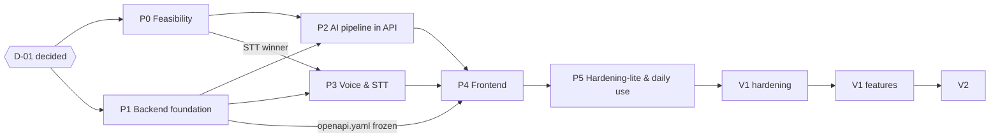

# Roadmap, Testing & Evaluation

Status: Approved for planning (rev 2) · Last updated 2026-11-22
Related: [product-requirements.md](product-requirements.md) · [architecture-and-ai-pipeline.md](architecture-and-ai-pipeline.md) · [data-and-api.md](data-and-api.md) · [decisions.md](decisions.md)

---

## 1. Test layers

| Layer | Scope |
|---|---|
| Domain unit (table-driven) | Date resolver (day boundary, DST, weekdays, year wrap), normalizer, **number-aware dedupe**, policy matrix, lifecycle, evidence matcher including the last-3-messages window |
| Use-case unit | Validator with canned model outputs (hallucinated alias, bad evidence, evidence from `U-3`, low confidence), apply logic |
| API integration (Testcontainers Postgres) | Endpoints, session, user isolation, concurrent duplicate requests on every idempotent path |
| DB | Migrations, unique constraints under concurrency, trigram index, retention purge |
| Structured-output contract | Recorded provider responses replayed through the validator, so CI is deterministic |
| Live eval | Golden set run against the real model and the STT transcript files, producing a metrics report |
| Frontend | Recorder state machine, tray editing, optimistic toggles, RTL rendering |
| E2E (Playwright) | Fake-mic audio, then tray, then apply, then Day view. Also an upload-retry case. |

### 1.1 Required dedupe unit cases

| Pair | Expected |
|---|---|
| "Review OS lecture 1" vs "Review OS lecture 2" | Not duplicate |
| "Review OS lecture 4" vs "Review OS lecture ٤" | Duplicate |
| "Reply to Ahmed" (Tue) vs "Reply to Ahmed about the project" (Tue) | Duplicate |
| "Reply to Ahmed" (Tue) vs "Reply to Ahmed" (Sat) | Not duplicate, because of the date |
| `duplicate_of: T5` where T5 is "lecture 1" and the new title is "lecture 2" | Not duplicate, because the numbers override |

### 1.2 Required date-resolver rows (minimum; the table grows to 50+)

| Clock (Africa/Cairo) | Expression | Expected |
|---|---|---|
| Mon 23 Nov 22:30 | بكرة | Tue 24 Nov |
| Mon 23 Nov 22:30 | بعد بكرة | Wed 25 Nov |
| Mon 23 Nov 22:30 | الخميس الجاي | Thu 26 Nov |
| Thu 26 Nov 20:00 | الخميس الجاي | Thu 3 Dec |
| Tue 24 Nov 00:45 | بكرة | Tue 24 Nov (day boundary) |
| Tue 24 Nov 04:10 | بكرة | Wed 25 Nov |
| Mon 23 Nov 22:30 | الجمعة | Fri 27 Nov |
| Thu 31 Dec 21:00 | بكرة | Fri 1 Jan (year wrap) |
| Last Thursday of April 23:30 (DST start window) | بكرة | Next calendar day, with no offset drift |

---

## 2. Evaluation

### 2.1 Golden set

- **Text cases (30):** §3 scenarios S1–S24 and S26–S29 form the core. About 2 more come from our own real nights.
- **Audio clips (20):** Recordings of scenarios such as S1, S4, S5, S12, S13, S15, S17, S22, and S26, about 10 from each of us. They cover a quiet room, a low voice in bed, and street noise.
- **What each case contains:** a fixed clock, timezone, existing tasks, pending tray, conversation history, and expected ops.
- **Matching:** Expected creates are matched to actual creates by keyword sets for simple cases. Otherwise, an LLM judge decides, with a human spot-check.
- **Leakage:** Few-shot examples in the prompt must never overlap the golden set.
- **Growth:** Every real failure found in daily use becomes a new case. The target is 60+ cases by V1.

### 2.2 Metrics & MVP gate

At 30 cases the gate is **directional**. A single case moves recall by several points.

| Metric | Definition | Gate |
|---|---|---|
| Create precision | Correct definite pre-checked items ÷ all pre-checked creates | ≥ 0.90 |
| Create recall | Expected definite tasks found, pre-checked or Maybe, ÷ expected | ≥ 0.85 |
| False-task rate | Cases with ≥ 1 invented or aspiration-as-definite pre-checked item | ≤ 1 case in 30 |
| Modify-op accuracy | Correct type **and** target ÷ expected modify ops | ≥ 0.90 |
| Wrong-target rate | Modify ops hitting the wrong task | 0 in the golden set |
| Date accuracy | Resolved date equals expected | ≥ 0.97 |
| Duplicate inserts on retry | Duplicates from replayed requests | **0 (hard)** |
| Semantic duplicate miss / false merge | A re-mention creates a new item, or distinct numbered items get merged | 0 in the golden set |
| Clarification appropriateness | Human-scored | ≥ 0.80 |
| STT entity accuracy | Names and English terms correct | Tracked. Used to pick the provider. |
| Latency | Stop → tray, p50/p95, on a 60 s clip | ≤ 5 s / ≤ 10 s |

**Product signals in daily use:**
- Tray acceptance rate.
- Items edited within 24 h of being applied.
- The share of sessions where everything is rejected, which is the "it got it wrong" signal.

---

## 3. Acceptance scenarios

Clock is Mon 2026-11-23 22:30 Africa/Cairo unless noted.

| # | Situation / utterance | Expected |
|---|---|---|
| S1 | The full example: "بص أنا النهاردة مخلصتش اللي ورايا خالص. عندي جزء في مشروع الـ AI لازم أخلصه بكرة، وكمان المفروض أراجع محاضرتين Operating Systems. نسيت كمان أرد على أحمد بخصوص المشروع. وكنت عايز أبدأ أتعلم Docker بس مش عارف هلاقي وقت ولا لأ." | **Pre-checked for Tue 24 Nov:** Finish AI project section (high), **Review OS lecture 1, Review OS lecture 2** (both kept by number-aware dedupe), Reply to Ahmed about the project. **Maybe:** Start learning Docker. **Also:** one Docker question, and no task from "مخلصتش اللي ورايا". |
| S2 | "عندي امتحان OS بكرة الساعة ١٠" | Zero ops. The reply offers to add a review task. |
| S3 | "لازم أراجع الفصل التالت قبل امتحان بكرة" | Create "Review chapter 3", scheduled Mon 23, with deadline Tue 24. |
| S4 | Existing task "Start learning Docker" on Tue. "بكرة مش هعمل Docker، خليها الجمعة" | reschedule_task to Fri 27 Nov. No create. |
| S5 | Pending tray item "Review OS lecture 3". "لا أنا قصدي محاضرة 4 مش محاضرة 3" | revise_proposal to "Review OS lecture 4". The tray still has 1 item. |
| S6 | Same as S5, but already applied as a task | update_task, shown as a change row. |
| S7 | Existing "Reply to Ahmed". "خلصت الرد على أحمد خلاص" | complete_task. |
| S8 | Existing "Gym" on Tue. "مش هروح الجيم بكرة خلاص" | cancel_task, not reschedule. |
| S9 | Existing "Reply to Ahmed" on Tue. "ومتنساش أرد على أحمد" | No new item. Notice "Already on Tuesday". |
| S10 | "هسلم الريبورت بعد بكرة" | Create on Wed 25 Nov. |
| S11 | "هقابل الدكتور الخميس الجاي", said Mon, then said again Thu 26 Nov | Thu 26 Nov the first time, Thu 3 Dec the second. The tray shows the explicit date. |
| S12 | Clock Tue 24 Nov 00:45. "بكرة لازم أخلص الـ slides" | Scheduled **Tue 24 Nov**, by the day-boundary rule. |
| S13 | "عايز أعمل deploy للـ backend وأكتب الـ unit tests بكرة" | 2 creates with English terms preserved: "Deploy the backend" and "Write unit tests". |
| S14 | "نفسي أبدأ أقرأ كتب أكتر" | Zero pre-checked items. At most one Maybe item. |
| S15 | "يومي كان وحش جدًا وأنا مخنوق ومش عايز أتكلم في حاجة" | Zero ops. An empathetic reply, with no productivity push. |
| S16 | 9 tasks with stated durations totaling 11 h for Tue | All extracted. Workload shows "over by 5h", and the reply suggests moving low-priority items. |
| S17 | STT gives "أراجع محاضرة الأوبريتنج سيستمز" (transliterated) | Title "Review Operating Systems lecture". |
| S18 | Transcript misheard "أمجد" for "أحمد", and the user edits the bubble | The new revision supersedes the pending item. The final tray has 1 "Reply to Ahmed" and no duplicate. |
| S19 | Network drops after the server applied items. The client retries apply. | Same task IDs returned. Task count unchanged. |
| S20 | Two existing tasks contain "lecture". "أجّل المحاضرة لبكرة" | No modify op. A clarification asks which lecture. |
| S21 | Tue morning: "انقل اللي مخلصتهوش امبارح للنهاردة" | Change rows moving each pending Mon task to Tue. defer_count goes up by 1. |
| S22 | English only: "Tomorrow I need to call the bank and maybe hit the gym" | Pre-checked "Call the bank". Maybe "Go to the gym". |
| S23 | "تلات محاضرات Networks لازم أذاكرهم الأسبوع ده" | 3 creates (lectures 1–3) in Later, plus a question about which days. |
| S24 | The user deletes the S1 conversation | Messages, runs, and evidence removed. The 4 tasks remain with source_message_id = null. |
| S25 | The same uploadId is sent twice | One transcription row and one STT call. |
| S26 | After S1, with the tray still pending, the user answers the Docker question: "خليها الخميس" | `revise_proposal` on the Docker item. Date Thu 26 Nov, moved to pre-checked. Evidence cites `U-1` (Docker) and `U-0` (the date). **No new item, and no re-proposal** of S1's other tasks. |
| S27 | Existing "Review OS lecture 1" on Tue. "وكمان محاضرة 2 بتاعة OS بكرة" | New pre-checked "Review OS lecture 2", not flagged as a duplicate. |
| S28 | The S1 Docker item was already applied as a Later task. The user answers "خليها الخميس" | reschedule_task from Later to Thu 26 Nov. No create. |
| S29 | The model outputs a create with confidence 0.3 for "ممكن أكلم خالد" | A Maybe item with the low-confidence flag. Not dropped and not pre-checked. |

---

## 4. Roadmap

**Capacity assumption:** 24 team-hours/week, from 2 people × 2 h/day × 6 days. Work runs in two tracks. **Track A** covers the AI and backend core. **Track B** covers the app and backend shell. Estimates are ±30%.

If D-01 is Go, the backend phases carry about 20% extra for the learning curve, shown in its own column.

| Phase | Effort (team-h) | Owner | Calendar weeks (base) | With Go |
|---|---|---|---|---|
| P0 Feasibility & eval harness | ~50 | A (B helps with recordings) | Wk 1–4 | Wk 1–5 |
| P1 Backend foundation | ~38 | B | Wk 1–3 | Wk 1–4 |
| P2 Conversation + AI pipeline in API | ~30 | A | Wk 5–7 | Wk 6–8 |
| P3 Voice capture & STT adapter | ~25 | B | Wk 4–6 | Wk 5–7 |
| P4 Frontend app | ~56 | B from wk 6 against mocks, A joins wk 8 | Wk 6–10 | Wk 7–11 |
| P5 Hardening-lite & own daily use | ~24 + 2 weeks of use | A + B | Wk 11–13 | Wk 12–14 |
| **Total** | **~223 h** | | **≈ 13 weeks (~3 months)** | **≈ 14–15 weeks** |

| Version | Themes |
|---|---|
| **MVP** (P0–P5) | The full voice → tray → checklist loop, for the two of us |
| **V1 hardening** | §4.1 |
| **V1 features** | Arabic UI, opt-in auto-apply with undo, SSE-streamed replies, rolling session summary, subtasks and dependencies, smarter overload suggestions, History screen, offline checklist, learned preferences (with confirmation), optional TTS replies |
| **V2** | Streaming STT and duplex voice, opt-in long-term memory, reminders and web push, calendar integration, recurrence, weekly insights, self-hosted or fine-tuned Egyptian STT, native wrapper |

### 4.1 V1 hardening list (moved out of the MVP)

- Registration, invite codes, Google sign-in, and account deletion. The MVP keeps "delete all my data".
- JSON data export.
- OpenTelemetry traces and metrics, with dashboards. The MVP has structured logs and `cost_usd` only.
- A generic `idempotency_keys` table and `Idempotency-Key` header.
- If-Match / row-version optimistic concurrency.
- A reverse proxy (Caddy), if deployment ever needs more than Next.js rewrites.
- A second STT adapter and an LLM provider fallback chain.
- An OWASP ASVS L1 review and a WCAG 2.2 AA audit, **as release gates**.
- A wider beta of 5–20 users, as a release gate.

---

## 5. Phase tasks & acceptance criteria

### P0: Feasibility & eval harness, the go/no-go (~50 h, wk 1–4)

**Prerequisite:** D-01 is decided.

**Tasks:**
- Write 30 text cases (§3 plus our own) and record 20 clips, about 10 each.
- Write the **throwaway Python STT bake-off** in `spikes/stt-bakeoff/`.
  - It outputs `transcripts/<provider>.json`.
  - It outputs a WER/CER, entity, latency, and cost table.
- In the chosen backend language, build `domain` with table tests:
  - date resolver
  - normalizer
  - number-aware dedupe
  - evidence matcher
  - policy
  - validator
- Build **one** `TurnAnalyzer` adapter and prompt v1.
- Build `cmd/eval`. It runs the text cases or the provider transcript files and writes a markdown report with the §2.2 metrics, per-case diffs, latency, and cost.

**Acceptance:**
- The eval runs with one command.
- Domain tests are green, including the §1.1 dedupe cases and the §1.2 date rows.
- The STT winner and the LLM choice are recorded in `decisions.md`, with numbers.
- The gate is met on text. If not, do 2 prompt iterations, then build a second LLM adapter and re-test. If it still misses badly, revisit the product approach before any UI work.

### P1: Backend foundation (~38 h, wk 1–3)

**Tasks:**
- **Setup:** project layout, Docker Compose Postgres, and migrations for the data model, including `pg_trgm`.
- **Accounts:** the 2 accounts are seeded, with login/logout sessions and settings.
- **Tasks API:** CRUD and lifecycle endpoints, `GET /days/{date}` with workload, and move-unfinished.
- **Cross-cutting:** Problem Details errors, structured logging with redaction, and simple limits.
- **Contract and CI:** `openapi.yaml` with a generated TypeScript client. CI builds, runs tests, and uses Testcontainers.

**Acceptance:**
- Integration tests cover user isolation, lifecycle rules, and concurrent duplicate `POST /tasks` with the same `id`, which must give one row.
- The TypeScript client generates cleanly.
- `docker compose up` gives a working local stack.

### P2: Conversation + AI pipeline in the API (~30 h, wk 5–7)

**Tasks:**
- Conversations and messages, and the context builder with aliases, `U-n` labels, and the open clarification.
- Run persistence with `cost_usd`.
- Tray edit and apply, supersede on message edit, and retry analysis.
- Retry and repair logic.

**Acceptance:**
- S1–S11, S13–S16, S18–S20, S22–S24, and S26–S29 pass as API tests with recorded model outputs.
- The live eval still meets the gate.
- A concurrent apply produces exactly one task per item.

### P3: Voice capture & STT (~25 h, wk 4–6)

**Tasks:**
- **Server:** `POST /transcriptions` with the **single winning adapter**. Audio is never persisted to disk. Each call is biased with the user's vocabulary.
- **Client recorder:**
  - the state machine
  - IndexedDB chunk buffer
  - MIME negotiation
  - waveform
  - wake lock
  - 5-minute cap

**Acceptance:**
- Recording works on both of our phones, in the browser and as an installed PWA. That means Chrome on Android, iOS Safari, or both, depending on what we own.
- Killing the tab mid-upload and reopening offers a retry with the audio intact.
- S25 passes.
- Stop → transcript is p95 ≤ 5 s for a 60 s clip.

### P4: Frontend app (~56 h, wk 6–10)

**Tasks:**
- **Login and Day view:** login, then the Day view with Today, Tomorrow and a date picker. It includes the task row, the edit sheet, and optimistic toggles.
- **Talk sheet:** the tray with inline edit, the clarification flow, the duplicate notice, and the low-confidence badge.
- **Settings & Privacy.**
- **Cross-cutting:**
  - RTL support
  - themes
  - reduced motion
  - the PWA manifest and service worker

**Acceptance:**
- Journeys J1–J6 can be completed on our phones.
- The Playwright E2E fake-mic flow passes.
- Arabic renders correctly everywhere.
- There are no obvious accessibility blockers. The mic is labelled and focus order is sane. The formal WCAG audit belongs to V1 hardening.

### P5: Hardening-lite & daily use (~24 h + 2 weeks, wk 11–13)

**Tasks:**
- The retention purge job and the delete flows.
- A daily SQL view of cost and latency, plus a provider spend alert.
- Polish for error states.
- Deploy Next.js, the backend, and managed Postgres, then drill a backup restore.
- **Both of us use the app every night for 2 weeks.** Every failure gets added to the golden set.

**Acceptance:**
- All §3 scenarios pass end-to-end.
- A restore from backup is verified.
- Over the 2 weeks, the tray acceptance rate is at least 80%, with zero duplicate-task incidents.

---

## 6. First milestone

**Milestone 1 is P0, "the Egyptian Arabic extraction proof".** It takes about 4 weeks at our pace, or about 5 with Go. It delivers:
- 30 text cases and 20 audio clips.
- The throwaway Python STT comparison.
- The pure domain core with table tests, in the chosen backend language.
- One LLM adapter.
- A one-command eval report.

**Why first:** It tests the one thing that can sink the product before any time goes into UI. Everything except the Python spike becomes production code and the permanent regression gate.

**Prerequisite:** decide D-01.
