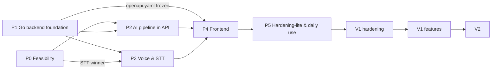

# Roadmap, Testing & Evaluation

Status: Planning, rev 3 · Last updated 2026-11-22 · Generated from [plan.md](plan.md); edit plan.md first, then re-split.

Section numbers match `plan.md` (rev 3, the source). Where each section lives: Part A, §1–§4, §10 → product-requirements.md · §5–§7, §11 → architecture-and-ai-pipeline.md · §8–§9 → data-and-api.md · §12–§14, §16 → roadmap-and-testing.md · §15 → decisions.md

---

## 12. Testing & evaluation strategy

### 12.1 Test layers

| Layer | Scope |
|---|---|
| `domain` unit (table tests) | Date resolver, normalizer + offset map, evidence locator, numbersMatch, policy matrix, lifecycle, op union decode, `set`/`clear` semantics, templates (summary, night line, ack) |
| `app` unit | Validator with canned outputs (bad alias, wrong alias kind, missing evidence, evidence from `U-3`, field in both set and clear, low confidence, re-proposal of a rejected item) |
| `store` + API integration (testcontainers-go) | Endpoints, session, user isolation, concurrent duplicate requests on every idempotent path, **all-or-nothing apply**, **stale revision 409**, **concurrent apply vs edit (exactly one winner)**, cascade deletes |
| DB fixture | The §7.5.1 score table, asserted to ±0.01 along with each pair's classification. A check that Arabic trigrams are generated. Runs against the target Postgres version and locale. |
| Structured-output contract | Recorded provider responses replayed through decode and validation (deterministic CI) |
| Live eval | Golden set against the real model and the STT transcript files. **Reported per split.** |
| Frontend | Recorder state machine, tray editing with revisions, 409 handling, optimistic toggles, RTL |
| E2E (Playwright) | Fake mic → tray → apply → ack → Day view. Upload retry. |

**`set`/`clear` unit cases:**

| Op | Expected effect on the task |
|---|---|
| `update_task {set:{priority:"high"}}` | `estimate_minutes` and `description` are untouched |
| `update_task {clear:["deadline"]}` | Only the deadline becomes null |
| `update_task {set:{title:"x"}, clear:["title"]}` | Rejected (`set_clear_conflict`) |

### 12.2 Golden set, splits & gate

**Composition:** 30 text cases and 20 audio clips, all from the two of us.

- **Held-out split (≥ 10 text cases)** comes from our **real nights**.
  - **When:** Recorded or written down **before prompt v1 is written**.
  - **Labels:** The speaker labels each case with its expected ops.
  - **Where:** Frozen in `eval/golden/heldout/`.
  - **Rule:** No prompt iteration may use held-out case details. If anyone opens a held-out failure to debug it, that case moves to dev and a new real night is recorded to replace it.
  - **Audio:** Real-night audio counts toward the 20 clips.
- **Dev split (20 text cases)** comes from the §12.3 scenarios: S1, S2, S3, S4, S5, S7, S8, S9, S11, S12, S13, S14, S15, S17, S20, S22, S23, S26, S29, S30.
  - **Other scenarios:** The remaining model scenarios (S6, S16, S18, S21, S27, S28) run as recorded-output contract tests. They join the dev split as it grows.
- **Matching:** Keyword sets for simple cases, otherwise an LLM judge with a human spot check.

**The gate must pass on each split separately.** It is directional at this size, because one case moves recall by several points.

| Metric | Definition | Gate (each split) |
|---|---|---|
| Create precision | Correct definite pre-checked ÷ all pre-checked creates | ≥ 0.90 |
| Create recall | Expected definite tasks found (pre-checked or Maybe) ÷ expected | ≥ 0.85 |
| False-task cases | Cases with ≥ 1 invented or aspiration-as-definite pre-checked item | ≤ 1 per split |
| Modify-op accuracy | Correct type **and** target ÷ expected modify ops | ≥ 0.90 |
| Wrong-target ops | Modify ops hitting the wrong task | 0 |
| Date accuracy | Resolved date = expected | ≥ 0.97 |
| Duplicate insert on retry / partial apply | Replayed and concurrent requests | **0 (hard)** |
| Semantic duplicate miss / false merge | Including re-proposals of rejected items | 0 |
| Overclaiming reply | The reply states a count or claims something was saved | 0 |
| Clarification appropriateness | Scored by a human | ≥ 0.80 |
| STT entity accuracy | Names and English terms correct | Tracked. Picks the provider. |
| Latency | Stop → tray p50/p95 on a 60 s clip | ≤ 5 s / ≤ 10 s |

**Product signals in daily use:** tray acceptance rate, items edited within 24 h of apply, and sessions where everything is rejected.

### 12.3 Acceptance scenarios (clock: Mon 2026-11-23 22:30 Cairo unless noted)

Titles are shown in the spoken language (D-04).

| # | Situation / utterance | Expected |
|---|---|---|
| S1 | "بص أنا النهاردة مخلصتش اللي ورايا خالص. عندي جزء في مشروع الـ AI لازم أخلصه بكرة، وكمان المفروض أراجع محاضرتين Operating Systems. نسيت كمان أرد على أحمد بخصوص المشروع. وكنت عايز أبدأ أتعلم Docker بس مش عارف هلاقي وقت ولا لأ." | Pre-checked, Tue 24 Nov: أخلص جزء مشروع الـ AI (high), **أراجع محاضرة 1 Operating Systems, أراجع محاضرة 2 Operating Systems** (both kept), أرد على أحمد بخصوص المشروع. Maybe: أبدأ أتعلم Docker. One Docker clarification. Summary "اقترحتلك ٤ حاجات، راجعها وأكد". **The reply has no count and no saved-claim.** No task from "مخلصتش اللي ورايا". |
| S2 | "عندي امتحان OS بكرة الساعة ١٠" | Zero ops. The reply offers help. |
| S3 | "لازم أراجع الفصل التالت قبل امتحان بكرة" | Create "أراجع الفصل 3", scheduled Mon 23, deadline Tue 24. |
| S4 | Existing task "أبدأ أتعلم Docker" (Tue). "بكرة مش هعمل Docker، خليها الجمعة" | reschedule_task → Fri 27 Nov. No create. |
| S5 | Pending "أراجع محاضرة 3 OS". "لا أنا قصدي محاضرة 4 مش محاضرة 3" | revise_proposal: set title → lecture 4. Revision +1. Still 1 item. |
| S6 | Same, but already applied | update_task `set:{title}` as a change row. Other fields untouched. |
| S7 | "خلصت الرد على أحمد خلاص" | complete_task. |
| S8 | Existing "الجيم" (Tue). "مش هروح الجيم بكرة خلاص" | cancel_task. |
| S9 | Existing "أرد على أحمد" (Tue). "ومتنساش أرد على أحمد" | No new item. Duplicate notice. |
| S10 | "هسلم الريبورت بعد بكرة" | Create Wed 25 Nov. |
| S11 | "هقابل الدكتور الخميس الجاي", said Mon, then said Thu 26 Nov | Thu 26 Nov, then Thu 3 Dec. |
| S12 | Clock Tue 24 Nov 00:45. "بكرة لازم أخلص الـ slides" | Scheduled **Tue 24 Nov**. The row shows "بكرة = التلات 24 نوفمبر". |
| S13 | "عايز أعمل deploy للـ backend وأكتب الـ unit tests بكرة" | "أعمل deploy للـ backend" and "أكتب الـ unit tests". English terms kept. |
| S14 | "نفسي أبدأ أقرأ كتب أكتر" | Zero pre-checked. At most one Maybe. |
| S15 | "يومي كان وحش جدًا وأنا مخنوق" | Zero ops. An empathetic reply. |
| S16 | 9 tasks totalling 11 h of stated time | All extracted. "Over by 5h" plus a suggestion to move low-priority items. |
| S17 | Transcript "أراجع محاضرة الأوبريتنج سيستمز" | Title "أراجع محاضرة Operating Systems" (the term restored to Latin as spoken). |
| S18 | "أمجد" misheard for "أحمد", and the user edits the bubble | New revision. Old pending item superseded. One "أرد على أحمد". |
| S19 | Network drops after a successful apply, and the client retries | 200 with the stored outcome. Same task IDs. Count unchanged. |
| S20 | Two "محاضرة" tasks. "أجّل المحاضرة لبكرة" | Clarification. No op shown. |
| S21 | Tue morning: "انقل اللي مخلصتهوش امبارح للنهاردة" | Change rows Mon → Tue. defer_count +1. |
| S22 | "Tomorrow I need to call the bank and maybe hit the gym" | Pre-checked "Call the bank". Maybe "Go to the gym" (English, as spoken). |
| S23 | "تلات محاضرات Networks لازم أذاكرهم الأسبوع ده" | 3 creates (محاضرة 1–3) in Later, plus a which-days question. |
| S24 | Delete the S1 conversation | Messages, transcriptions, runs, and proposal items with evidence are removed. Tasks remain with source_message_id and evidence_ref null. |
| S25 | Same uploadId sent twice | One transcription row. One STT call. |
| S26 | After S1, tray still pending: "خليها الخميس" | revise_proposal on the Docker item: date Thu 26 Nov, moved to pre-checked. Evidence located in `U-1` and `U-0`. No new item, and no re-proposal of S1's other tasks. |
| S27 | Existing "أراجع محاضرة 1 OS" (Tue). "وكمان محاضرة 2 بتاعة OS بكرة" | New pre-checked "أراجع محاضرة 2 OS". Not a duplicate. |
| S28 | The Docker item is already applied as Later. "خليها الخميس" | reschedule_task Later → Thu 26 Nov. |
| S29 | The model emits a create with confidence 0.3 for "ممكن أكلم خالد" | A Maybe item with the low-confidence flag. |
| **S30** | After S1, the user rejects the Docker item (✕), then says "وكمان لازم أذاكر للكويز بتاع الـ Networks". The model re-proposes "أبدأ أتعلم Docker" citing only `U-1`. | **No Docker item** (dropped, `reproposal_of_earlier_item`, no notice). The new quiz item appears. |
| **S31** | Apply and message-edit sent concurrently for the same pending items | Exactly one commits. If apply wins, the edit's analysis sees the tasks as `T#`. If the edit wins, apply returns 409 `not_pending`/`stale_revision` and nothing is saved. |
| **S32** | Apply of two items where one has a stale revision | 409 listing the stale item. **Neither** item is applied. |
| **S33** | Successful apply of 4 items | The acknowledgement is a `template_ack` message whose count and date come from the apply response ("تمام، ضفت ٤ حاجات لبكرة (التلات 24 نوفمبر)."). |

---

## 13. Roadmap, estimates & dependencies

**Estimates are in team-hours, which are the real numbers.** They include the Go learning overhead and the rev-3 additions: the op union, all-or-nothing apply, the apply/edit race, evidence offsets, and deletion scope.

**Calendar weeks are rough.** They assume about 2 h/day each in two tracks, but we work when we're free.
- **Track A:** AI and core.
- **Track B:** App and shell.

| Phase | Effort (team-h) | Owner | Rough calendar |
|---|---|---|---|
| P0 Feasibility & eval harness (Go) | ~62 | A, with B on real nights and recordings | wk 1–5 |
| P1 Go backend foundation | ~46 | B | wk 1–4 |
| P2 Conversation + AI pipeline in API | ~40 | A | wk 6–9 |
| P3 Voice capture & STT adapter | ~26 | B | wk 5–6 |
| P4 Frontend app | ~57 | B from wk 7 against mocks, A from wk 10 | wk 7–10 |
| P5 Hardening-lite & own daily use | ~27 + 2 weeks of nightly use | A + B | wk 11–13 |
| **Total** | **~258 h** | | **≈ 13–14 weeks if we average 2 h/day each** |

| Version | Themes |
|---|---|
| **MVP** (P0–P5) | The full voice → tray → checklist loop for the two of us |
| **V1 hardening** | §13.1 |
| **V1 features** | Arabic UI. Opt-in auto-apply with undo. SSE replies. Rolling summary. Subtasks and dependencies. Smarter overload suggestions. History screen. Offline checklist. Learned preferences. Optional TTS. |
| **V2** | Streaming STT and duplex voice. Opt-in long-term memory. Reminders and push. Calendar integration. Recurrence. Weekly insights. Self-hosted or fine-tuned Egyptian STT. Native wrapper. |

### 13.1 V1 hardening list

**Accounts and data:**
- Registration, invite codes, Google sign-in, and account deletion.
- JSON data export.

**Infrastructure and concurrency:**
- OpenTelemetry traces and dashboards.
- A generic `idempotency_keys` table and an `Idempotency-Key` header.
- If-Match and row versions on tasks.
- Caddy, if deployment ever needs more than Next.js rewrites.
- A second STT adapter and an LLM fallback chain.

**Release gates:**
- An ASVS L1 review and a WCAG 2.2 AA audit.
- A 5–20 user beta.

---

## 14. Phase tasks & acceptance criteria

**P0, Feasibility & eval harness (~62 h)**

Tasks:
1. **Record the held-out set first.** Each of us writes down or records about 5 real nightly brain-dumps and labels their expected ops. They are frozen in `eval/golden/heldout/` before prompt v1 exists.
2. **Write the 20 dev cases** from the §12.3 scenarios, and record 20 clips (real-night audio counts toward them).
3. **Run the throwaway Python STT bake-off.**
4. **Build the Go `internal/domain` package.** It contains dates, normalization with an offset map, the evidence locator, numbersMatch, policy, lifecycle, op-union decode, `set`/`clear`, and templates, all with table tests.
5. **Build one `TurnAnalyzer` adapter and prompt v1.**
6. **Build `cmd/eval`.** It uses Compose Postgres for trigram scores, reads the text cases or the provider transcript files, and writes a markdown report **per split**. The report includes the metrics, dev per-case diffs, held-out pass/fail only, latency, and cost. For golden cases only, raw model outputs go into the local report.

Acceptance:
- The eval runs with one command.
- Domain tests are green, including the §7.5.1 fixture and the set/clear cases.
- The STT and LLM choices are recorded in `decisions.md` with numbers.
- **The gate is met on both splits.** If not, iterate the prompt twice. If it still misses, build a second LLM adapter and re-test. If it still misses badly, revisit the approach before any UI work.

**P1, Go backend foundation (~46 h)**

Tasks:
- Layout per §5.2, Compose Postgres, and goose migrations for §8, including pg_trgm and the cascades.
- sqlc queries.
- Seeded accounts with scs sessions.
- Settings.
- Task CRUD and lifecycle, `days`, and move-unfinished.
- Problem Details, slog redaction, and rate limits.
- `openapi.yaml`, with oapi-codegen types and a generated TypeScript client.
- CI running `go test`, `govulncheck`, and testcontainers-go.
- Decide net/http vs chi.

Acceptance:
- Isolation tests pass.
- Concurrent `POST /tasks` with the same id produces one row.
- Lifecycle rules hold.
- Deleting a task removes its events.
- **The §7.5.1 fixture passes against the managed Postgres we'll deploy on.** This includes the Arabic trigram check.
- `docker compose up` gives a working local stack.

**P2, Conversation + AI pipeline in API (~40 h)**

Tasks:
- Conversations and messages.
- The context builder: aliases, `U-n` labels, and the open clarification.
- Runs with reason codes and `cost_usd`.
- The tray with revisions: PATCH, and all-or-nothing apply with the conversation lock and the retry rule.
- Message edit with supersede under the same lock.
- The acknowledgement template.
- Retry and repair.
- Conversation delete, cascading to transcriptions and evidence.

Acceptance:
- S1–S11, S13–S16, S18–S20, S22–S24, and S26–S33 pass as API tests with recorded outputs.
- S31 is run 100× concurrently with exactly one winner each time.
- The live eval still passes on both splits.

**P3, Voice capture & STT (~26 h)**

Tasks:
- `POST /transcriptions` with the single winning adapter. No disk writes. Vocabulary biasing.
- The client recorder state machine, IndexedDB chunks, MIME negotiation, waveform, wake lock, and the 5-minute cap.

Acceptance:
- Recording works on both our phones, in the browser and as an installed PWA.
- A tab killed mid-upload offers a retry with the audio intact.
- S25 passes.
- Stop → transcript p95 ≤ 5 s on a 60 s clip.

**P4, Frontend app (~57 h)**

Tasks:
- Login.
- Day view: Today, Tomorrow, and a date picker, with the task row, edit sheet, and optimistic toggles.
- Talk sheet:
  - the reply, then the tray summary, items, and clarification row
  - inline edit with revisions
  - apply, 409 conflict highlighting, and the ack bubble
  - the night date line
  - duplicate notice and low-confidence badge
- Settings & Privacy.
- RTL, themes, reduced motion, and the PWA shell.

Acceptance:
- J1–J6 can be completed on our phones.
- The Playwright fake-mic flow passes.
- Arabic and mixed-script titles render correctly.
- No obvious accessibility blockers.

**P5, Hardening-lite & daily use (~27 h + 2 weeks)**

Tasks:
- The retention and orphan-transcription purge job.
- Verifying the delete flows for S24 and "delete all".
- A cost and latency SQL view, plus a spend alert.
- Polishing the error states.
- Deploying, with a backup-restore drill.
- **Both of us using it nightly for 2 weeks.** Real failures go into the dev split, and new real nights refresh the held-out split.

Acceptance:
- All §12.3 scenarios pass end-to-end.
- A restore has been verified.
- Over the 2 weeks, tray acceptance is ≥ 80%, with zero duplicate or partial-apply incidents.

---

## 16. First milestone

**Milestone 1 = P0, "the Egyptian Arabic extraction proof"** (~62 h, about 5 rough weeks).

**Order of work:**
1. Record the real-night held-out cases.
2. Write the dev cases and clips.
3. Run the Python STT spike.
4. Build the pure Go domain package with table tests, plus the §7.5.1 fixture.
5. Build one LLM adapter and prompt v1.
6. Generate a one-command eval report per split.

**Why first:** It tests the one thing that can sink the product before any UI time is spent. Everything except the Python spike becomes production code and the permanent regression gate.
