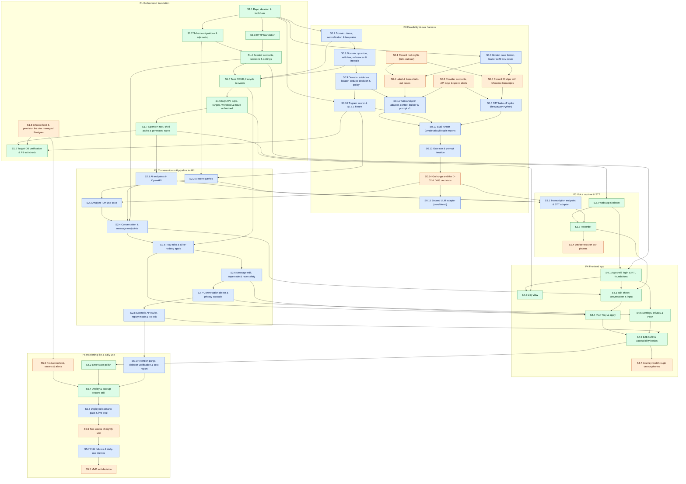

# Roadmap: phases → milestones → sprints

Planned by scope, not dates. Each sprint is one unit of work that one agent can finish in one or two sessions, and it ends with tests green. Live status lives in [STATUS.md](STATUS.md). The status column here is only the initial state.

Sprints: **51** · Claude Code: **22** · Codex: **18** · Human: **11**

| ID | Title | Phase | Milestone | Owner | Reviewer | Depends on | Status |
|---|---|---|---|---|---|---|---|
| [S0.1](sprints/S0.1-real-nights.md) | Record real nights (held-out raw) | [P0](phases/P0.md) | [M0.1](milestones/M0.1-golden-data.md) | Human | Codex | — | todo |
| [S0.2](sprints/S0.2-provider-keys.md) | Provider accounts, API keys & spend alerts | [P0](phases/P0.md) | [M0.1](milestones/M0.1-golden-data.md) | Human | Claude Code | — | todo |
| [S0.3](sprints/S0.3-golden-format.md) | Golden case format, loader & 20 dev cases | [P0](phases/P0.md) | [M0.1](milestones/M0.1-golden-data.md) | Claude Code | Codex | [S1.1](sprints/S1.1-repo-skeleton.md) | todo |
| [S0.4](sprints/S0.4-heldout-labels.md) | Label & freeze held-out cases | [P0](phases/P0.md) | [M0.1](milestones/M0.1-golden-data.md) | Human | Codex | [S0.1](sprints/S0.1-real-nights.md), [S0.3](sprints/S0.3-golden-format.md) | todo |
| [S0.5](sprints/S0.5-audio-clips.md) | Record 20 clips with reference transcripts | [P0](phases/P0.md) | [M0.1](milestones/M0.1-golden-data.md) | Human | Claude Code | [S0.1](sprints/S0.1-real-nights.md), [S0.3](sprints/S0.3-golden-format.md) | todo |
| [S0.7](sprints/S0.7-domain-dates-normalize.md) | Domain: dates, normalization & templates | [P0](phases/P0.md) | [M0.2](milestones/M0.2-domain-core.md) | Claude Code | Codex | [S1.1](sprints/S1.1-repo-skeleton.md) | todo |
| [S0.8](sprints/S0.8-domain-ops.md) | Domain: op union, set/clear, references & lifecycle | [P0](phases/P0.md) | [M0.2](milestones/M0.2-domain-core.md) | Claude Code | Codex | [S0.7](sprints/S0.7-domain-dates-normalize.md) | todo |
| [S0.9](sprints/S0.9-domain-evidence-policy.md) | Domain: evidence locator, dedupe decision & policy | [P0](phases/P0.md) | [M0.2](milestones/M0.2-domain-core.md) | Claude Code | Codex | [S0.8](sprints/S0.8-domain-ops.md) | todo |
| [S0.10](sprints/S0.10-trigram-fixture.md) | Trigram scorer & §7.5.1 fixture | [P0](phases/P0.md) | [M0.2](milestones/M0.2-domain-core.md) | Claude Code | Codex | [S1.1](sprints/S1.1-repo-skeleton.md), [S0.9](sprints/S0.9-domain-evidence-policy.md) | todo |
| [S0.6](sprints/S0.6-stt-bakeoff.md) | STT bake-off spike (throwaway Python) | [P0](phases/P0.md) | [M0.3](milestones/M0.3-stt-bakeoff.md) | Claude Code | Codex | [S0.2](sprints/S0.2-provider-keys.md), [S0.5](sprints/S0.5-audio-clips.md) | todo |
| [S0.11](sprints/S0.11-analyzer-prompt-v1.md) | Turn analyzer adapter, context builder & prompt v1 | [P0](phases/P0.md) | [M0.4](milestones/M0.4-extraction-proof.md) | Claude Code | Codex | [S0.9](sprints/S0.9-domain-evidence-policy.md), [S0.4](sprints/S0.4-heldout-labels.md), [S0.2](sprints/S0.2-provider-keys.md) | todo |
| [S0.12](sprints/S0.12-eval-runner.md) | Eval runner (cmd/eval) with split reports | [P0](phases/P0.md) | [M0.4](milestones/M0.4-extraction-proof.md) | Claude Code | Codex | [S0.11](sprints/S0.11-analyzer-prompt-v1.md), [S0.10](sprints/S0.10-trigram-fixture.md), [S0.6](sprints/S0.6-stt-bakeoff.md) | todo |
| [S0.13](sprints/S0.13-gate-run.md) | Gate run & prompt iteration | [P0](phases/P0.md) | [M0.4](milestones/M0.4-extraction-proof.md) | Claude Code | Codex | [S0.12](sprints/S0.12-eval-runner.md) | todo |
| [S0.14](sprints/S0.14-go-no-go.md) | Go/no-go and the D-02 & D-03 decisions | [P0](phases/P0.md) | [M0.4](milestones/M0.4-extraction-proof.md) | Human | Claude Code | [S0.13](sprints/S0.13-gate-run.md) | todo |
| [S0.15](sprints/S0.15-second-adapter.md) | Second LLM adapter (conditional) | [P0](phases/P0.md) | [M0.4](milestones/M0.4-extraction-proof.md) | Claude Code | Codex | [S0.14](sprints/S0.14-go-no-go.md) | blocked |
| [S1.1](sprints/S1.1-repo-skeleton.md) | Repo skeleton & toolchain | [P1](phases/P1.md) | [M1.1](milestones/M1.1-repo-and-schema.md) | Codex | Claude Code | — | todo |
| [S1.2](sprints/S1.2-schema-migrations.md) | Schema migrations & sqlc setup | [P1](phases/P1.md) | [M1.1](milestones/M1.1-repo-and-schema.md) | Codex | Claude Code | [S1.1](sprints/S1.1-repo-skeleton.md) | todo |
| [S1.3](sprints/S1.3-http-foundation.md) | HTTP foundation | [P1](phases/P1.md) | [M1.2](milestones/M1.2-http-and-auth.md) | Codex | Claude Code | [S1.1](sprints/S1.1-repo-skeleton.md) | todo |
| [S1.4](sprints/S1.4-auth-settings.md) | Seeded accounts, sessions & settings | [P1](phases/P1.md) | [M1.2](milestones/M1.2-http-and-auth.md) | Codex | Claude Code | [S1.2](sprints/S1.2-schema-migrations.md), [S1.3](sprints/S1.3-http-foundation.md) | todo |
| [S1.5](sprints/S1.5-task-crud.md) | Task CRUD, lifecycle & events | [P1](phases/P1.md) | [M1.3](milestones/M1.3-task-api.md) | Codex | Claude Code | [S1.4](sprints/S1.4-auth-settings.md), [S0.7](sprints/S0.7-domain-dates-normalize.md), [S0.8](sprints/S0.8-domain-ops.md) | todo |
| [S1.6](sprints/S1.6-days-workload.md) | Day API: days, ranges, workload & move-unfinished | [P1](phases/P1.md) | [M1.3](milestones/M1.3-task-api.md) | Codex | Claude Code | [S1.5](sprints/S1.5-task-crud.md) | todo |
| [S1.7](sprints/S1.7-openapi-shell.md) | OpenAPI root, shell paths & generated types | [P1](phases/P1.md) | [M1.4](milestones/M1.4-contract-and-target-db.md) | Codex | Claude Code | [S1.6](sprints/S1.6-days-workload.md) | todo |
| [S1.8](sprints/S1.8-provision-db.md) | Choose host & provision the dev managed Postgres | [P1](phases/P1.md) | [M1.4](milestones/M1.4-contract-and-target-db.md) | Human | Codex | — | todo |
| [S1.9](sprints/S1.9-p1-exit.md) | Target-DB verification & P1 exit check | [P1](phases/P1.md) | [M1.4](milestones/M1.4-contract-and-target-db.md) | Codex | Claude Code | [S1.7](sprints/S1.7-openapi-shell.md), [S1.8](sprints/S1.8-provision-db.md), [S0.10](sprints/S0.10-trigram-fixture.md) | todo |
| [S2.1](sprints/S2.1-openapi-ai.md) | AI endpoints in OpenAPI | [P2](phases/P2.md) | [M2.1](milestones/M2.1-turn-pipeline.md) | Claude Code | Codex | [S1.7](sprints/S1.7-openapi-shell.md) | todo |
| [S2.2](sprints/S2.2-store-ai.md) | AI store queries | [P2](phases/P2.md) | [M2.1](milestones/M2.1-turn-pipeline.md) | Claude Code | Codex | [S1.2](sprints/S1.2-schema-migrations.md), [S0.10](sprints/S0.10-trigram-fixture.md) | todo |
| [S2.3](sprints/S2.3-analyze-turn.md) | AnalyzeTurn use case | [P2](phases/P2.md) | [M2.1](milestones/M2.1-turn-pipeline.md) | Claude Code | Codex | [S2.2](sprints/S2.2-store-ai.md), [S0.14](sprints/S0.14-go-no-go.md) | todo |
| [S2.4](sprints/S2.4-conversation-endpoints.md) | Conversation & message endpoints | [P2](phases/P2.md) | [M2.1](milestones/M2.1-turn-pipeline.md) | Claude Code | Codex | [S2.3](sprints/S2.3-analyze-turn.md), [S2.1](sprints/S2.1-openapi-ai.md), [S1.4](sprints/S1.4-auth-settings.md) | todo |
| [S2.5](sprints/S2.5-apply.md) | Tray edits & all-or-nothing apply | [P2](phases/P2.md) | [M2.2](milestones/M2.2-safe-apply.md) | Claude Code | Codex | [S2.4](sprints/S2.4-conversation-endpoints.md), [S1.5](sprints/S1.5-task-crud.md) | todo |
| [S2.6](sprints/S2.6-edit-race.md) | Message edit, supersede & race safety | [P2](phases/P2.md) | [M2.2](milestones/M2.2-safe-apply.md) | Claude Code | Codex | [S2.5](sprints/S2.5-apply.md) | todo |
| [S2.7](sprints/S2.7-conversation-delete.md) | Conversation delete & privacy cascade | [P2](phases/P2.md) | [M2.3](milestones/M2.3-privacy-and-scenarios.md) | Claude Code | Codex | [S2.6](sprints/S2.6-edit-race.md) | todo |
| [S2.8](sprints/S2.8-p2-exit.md) | Scenario API suite, replay mode & P2 exit | [P2](phases/P2.md) | [M2.3](milestones/M2.3-privacy-and-scenarios.md) | Claude Code | Codex | [S2.7](sprints/S2.7-conversation-delete.md) | todo |
| [S3.1](sprints/S3.1-transcription-api.md) | Transcription endpoint & STT adapter | [P3](phases/P3.md) | [M3.1](milestones/M3.1-transcription-api.md) | Claude Code | Codex | [S0.14](sprints/S0.14-go-no-go.md), [S2.1](sprints/S2.1-openapi-ai.md), [S2.2](sprints/S2.2-store-ai.md) | todo |
| [S3.2](sprints/S3.2-web-skeleton.md) | Web app skeleton | [P3](phases/P3.md) | [M3.2](milestones/M3.2-recorder-on-phones.md) | Codex | Claude Code | [S1.7](sprints/S1.7-openapi-shell.md) | todo |
| [S3.3](sprints/S3.3-recorder.md) | Recorder | [P3](phases/P3.md) | [M3.2](milestones/M3.2-recorder-on-phones.md) | Codex | Claude Code | [S3.2](sprints/S3.2-web-skeleton.md), [S3.1](sprints/S3.1-transcription-api.md) | todo |
| [S3.4](sprints/S3.4-device-tests.md) | Device tests on our phones | [P3](phases/P3.md) | [M3.2](milestones/M3.2-recorder-on-phones.md) | Human | Codex | [S3.3](sprints/S3.3-recorder.md) | todo |
| [S4.1](sprints/S4.1-app-shell.md) | App shell, login & RTL foundations | [P4](phases/P4.md) | [M4.1](milestones/M4.1-shell-and-day-view.md) | Codex | Claude Code | [S3.2](sprints/S3.2-web-skeleton.md), [S1.4](sprints/S1.4-auth-settings.md) | todo |
| [S4.2](sprints/S4.2-day-view.md) | Day view | [P4](phases/P4.md) | [M4.1](milestones/M4.1-shell-and-day-view.md) | Codex | Claude Code | [S4.1](sprints/S4.1-app-shell.md), [S1.6](sprints/S1.6-days-workload.md) | todo |
| [S4.3](sprints/S4.3-talk-sheet.md) | Talk sheet: conversation & input | [P4](phases/P4.md) | [M4.2](milestones/M4.2-talk-and-tray.md) | Codex | Claude Code | [S4.1](sprints/S4.1-app-shell.md), [S3.3](sprints/S3.3-recorder.md), [S2.4](sprints/S2.4-conversation-endpoints.md) | todo |
| [S4.4](sprints/S4.4-plan-tray.md) | Plan Tray & apply | [P4](phases/P4.md) | [M4.2](milestones/M4.2-talk-and-tray.md) | Codex | Claude Code | [S4.3](sprints/S4.3-talk-sheet.md), [S2.5](sprints/S2.5-apply.md), [S2.6](sprints/S2.6-edit-race.md) | todo |
| [S4.5](sprints/S4.5-settings-pwa.md) | Settings, privacy & PWA | [P4](phases/P4.md) | [M4.3](milestones/M4.3-settings-pwa-e2e.md) | Codex | Claude Code | [S4.1](sprints/S4.1-app-shell.md), [S2.7](sprints/S2.7-conversation-delete.md) | todo |
| [S4.6](sprints/S4.6-e2e.md) | E2E suite & accessibility basics | [P4](phases/P4.md) | [M4.3](milestones/M4.3-settings-pwa-e2e.md) | Codex | Claude Code | [S4.4](sprints/S4.4-plan-tray.md), [S4.5](sprints/S4.5-settings-pwa.md), [S2.8](sprints/S2.8-p2-exit.md) | todo |
| [S4.7](sprints/S4.7-journeys.md) | Journey walkthrough on our phones | [P4](phases/P4.md) | [M4.3](milestones/M4.3-settings-pwa-e2e.md) | Human | Codex | [S4.6](sprints/S4.6-e2e.md) | todo |
| [S5.1](sprints/S5.1-purge-cost.md) | Retention purge, deletion verification & cost report | [P5](phases/P5.md) | [M5.1](milestones/M5.1-hardening.md) | Claude Code | Codex | [S2.8](sprints/S2.8-p2-exit.md) | todo |
| [S5.2](sprints/S5.2-error-states.md) | Error-state polish | [P5](phases/P5.md) | [M5.1](milestones/M5.1-hardening.md) | Codex | Claude Code | [S4.6](sprints/S4.6-e2e.md) | todo |
| [S5.3](sprints/S5.3-provision-prod.md) | Production host, secrets & alerts | [P5](phases/P5.md) | [M5.2](milestones/M5.2-deploy.md) | Human | Codex | [S1.8](sprints/S1.8-provision-db.md) | todo |
| [S5.4](sprints/S5.4-deploy.md) | Deploy & backup restore drill | [P5](phases/P5.md) | [M5.2](milestones/M5.2-deploy.md) | Codex | Claude Code | [S5.3](sprints/S5.3-provision-prod.md), [S5.2](sprints/S5.2-error-states.md), [S5.1](sprints/S5.1-purge-cost.md) | todo |
| [S5.5](sprints/S5.5-deployed-scenarios.md) | Deployed scenario pass & live eval | [P5](phases/P5.md) | [M5.3](milestones/M5.3-daily-use.md) | Claude Code | Codex | [S5.4](sprints/S5.4-deploy.md) | todo |
| [S5.6](sprints/S5.6-daily-use.md) | Two weeks of nightly use | [P5](phases/P5.md) | [M5.3](milestones/M5.3-daily-use.md) | Human | Claude Code | [S5.5](sprints/S5.5-deployed-scenarios.md) | todo |
| [S5.7](sprints/S5.7-fold-failures.md) | Fold failures & daily-use metrics | [P5](phases/P5.md) | [M5.3](milestones/M5.3-daily-use.md) | Claude Code | Codex | [S5.6](sprints/S5.6-daily-use.md) | todo |
| [S5.8](sprints/S5.8-mvp-exit.md) | MVP exit decision | [P5](phases/P5.md) | [M5.3](milestones/M5.3-daily-use.md) | Human | Claude Code | [S5.7](sprints/S5.7-fold-failures.md) | todo |

## Dependency graph

Colors: Claude Code = blue, Codex = green, Human = orange. An arrow means "must be done before".

